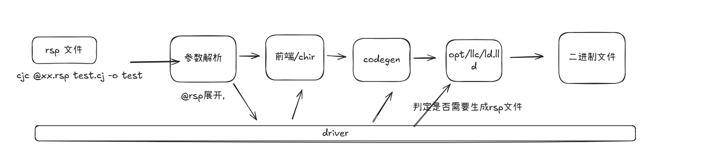

# Response File 特性设计

# **1、特性需求/问题/动机的来源与价值**

## 1.1 背景与目标

考虑以下场景:在 Windows 中,当用户向 `gcc` 传递的命令行参数较多时,进程可能直接启动失败,而 `cjc` 也会存在类似的问题。

``` cmd
gcc C:\opt\buildtools\rsp_wintest\main.c -o test  -O2 -pipe -time -dumpmachine  -print-libgcc-file-name -print-sysroot -print-sysroot-headers-suffix -print-multi-os-directory  -o test  -O2 -pipe -time -dumpmachine  -print-libgcc-file-name -print-sysroot -print-sysroot-headers-suffix -print-multi-os-director -o test  -O2 -pipe -time -dumpmachine  -print-libgcc-file-name -print-sysroot -print-sysroot-headers-suffix 
xxx
输入行太长。
```

**根因**:Windows `CreateProcessA` 命令行字符串长度上限为 32767 字符,（cmd 命令行中为 8191）一旦 `cjc` 收到的参数总长超过该值,操作系统直接拒绝启动进程,且无任何兜底。Linux/macOS 虽有 `ARG_MAX`(典型 2 MB)限制,常规工程不易触发,但 Windows 大工程(尤其是链接阶段参数多)极易撞到该硬限制。

### 1.1.1 目标

为绕开上述系统命令行长度限制,本特性**仅为 `cjc` 提供一种"从文件读取命令行参数"的入口**:用户把过长的参数写入一个文本文件(下文称 rsp 文件),`cjc` 读取该文件内容、按既定规则切分为参数 token、展开到命令行对应位置,等价于把这些参数直接写在命令行上。

**术语**:该文件即业界通称的 **response file(响应文件)**,常取扩展名 `.rsp`(故简称 rsp 文件)——一份纯文本参数清单,由工具自己读取并展开,以绕开 shell/OS 的命令行长度限制。MSVC `link.exe @link.rsp`、GCC/Clang、GNU ld、lld 的 `@file` 都是同一机制。

**关键术语速览**:

| 术语 | 一句话解释 |
| --- | --- |
| `argv` | 程序启动后拿到的**参数数组**(`argv[0]` 是程序名自身)。长度限制限制的是原始字符串;参数切得对不对,取决于用什么规则把字符串切分成 argv |
| `CreateProcessA` | Windows 创建子进程的系统 API。它只接收**一整条命令行字符串**(上限 32767 字符),切分参数不是它的职责 |
| **CRT** | C 运行时库(C Runtime Library)。Windows 上程序被启动后,由程序内的 CRT 启动代码把那**一整条字符串**切分成 argv——这套切分规则即后文所说的"CRT 规则 / CRT 风格 / CRT 套",也是 `CommandLineToArgvW` 的规则。MSVC `link.exe`、CMake/Ninja 生成的 rsp、Windows 上的 ld.lld 全部遵循它,它是 Windows 用户"反斜杠路径不转义"习惯的来源(详见 §4.3.3 开头) |
| `CommandLineToArgvW` | Windows 官方提供的"命令行字符串 → argv"转换 API,与 CRT 规则同源;微软官方文档对规则逐条成文(§4.3.3 引用) |
| GNU 风格 | GCC / GNU ld / Linux 与 macOS 上的 lld 通用的 rsp 解析习惯:`'`/`"` 都是引号,引号内外 `\X` 一律转义(吃 `\`) |
| CRT 风格 | 上文 CRT 规则的引号/反斜杠行为:仅 `"` 是引号;`\` 仅在紧贴 `"` 时特殊(2n 配对),其余位置一律普通字符 |
| bash 风格 | bash shell 的引号/转义语义(不含变量/命令展开):无引号 `\X`→X、单引号内全字面、双引号内仅 5 种转义、`#` 注释、行尾 `\` 续行 |
| MinGW | Windows 上的一套 GNU 工具链环境。cjc 在 Windows 上使用的链接器 `ld.lld.exe` 以 MinGW 驱动模式运行,解析 rsp 与命令行均遵循 CRT 风格 |

https://gcc.gnu.org/wiki/Response_Files 


## 1.2 适用场景
- Windows 命令行长度上限 32767 字符,进程可能启动失败;
- 用户工程依赖、库目录、源文件较多,命令行参数过长不便阅读与复用;

## 1.3 实现前 vs 实现后对比

**实现前**:用户必须把所有参数挤在命令行里,Windows 大工程链接时一旦超 32767 字符直接启动失败,无任何兜底。

```bash
# 实现前:命令行参数过长,不便维护
cjc -L"third party/lib" -lfoo -lbar -lbaz -g -O0 src/main.cj
```

**实现后**:用户侧可以写 rsp 文件沉淀配置启动。

```bash
# 用户侧:配置沉淀到文件
cjc @build/options.rsp
cjc -O0 @build/common.rsp -O2 src/main.cj   # 与命令行混用
```

# **2、特性影响分析**

本特性只影响 driver 读取命令行选项的阶段:rsp 展开发生在选项解析之前,展开后行为与参数直写命令行完全一致,不改动编译、链接等后续 pipeline。


# **3、业界竞品分析**

## 3.1 用户视角:业界使用方式

- **GCC/Clang**:`gcc @args.txt main.c`,args.txt 内每行一个参数,支持引号与 `\` 转义;**不支持 `#` 注释**(`#` 行的 token 会被当成参数/输入文件`)。
- **GNU ld / lld / lld-link**:`ld @link.rsp`,语法与 GCC `@file` 基本一致(lld 为兼容 GNU ld 而设计)。
- **MSVC `link.exe`**:`link @link.rsp`,语法为 Windows 风格(每行一个 arg,空格分隔的 arg 不需引号)。

**官方文档索引**:

| 工具 | 用户手册 | 语法真正定义处(源码) |
| --- | --- | --- |
| GCC | <https://gcc.gnu.org/onlinedocs/gcc/Overall-Options.html>(页末 `@file` 段) | libiberty `argv.c` 的 `expandargv` |
| GNU ld | <https://sourceware.org/binutils/docs/ld/Options.html> | binutils `ld/`(与 libiberty 同源) |
| clang / lld | 无专门手册页 | `llvm/lib/Support/CommandLine.cpp`(`ExpansionContext::expandResponseFiles`)+ `lld/Common/Args.cpp` |
| MSVC `link.exe` | <https://learn.microsoft.com/en-us/cpp/build/reference/at-specify-a-linker-response-file> | 闭源,以文档为准 |


## 3.2 设计者视角:实现方案

| 工具 | rsp 解析器 | `\` 转义 | 行续接 | `#` 注释 | 嵌套 `@file` |
| --- | --- | --- | --- | --- | --- |
| GCC | `libiberty` 的 `expandargv` | 支持(单/双引号内都认) | 换行符转义进 token(token 跨行,`\n` 保留,非 bash 式拼接) | **不支持**(实测:`#` 行被当输入文件) | 支持 |
| GNU ld / lld | `lld/Common/Args.cpp` / binutils | 支持(单/双引号内都认) | 同 GCC(换行转义进 token) | **不支持**(实测 GNU ld:`cannot find #`;lld 的 `TokenizeGNUCommandLine` 亦无注释逻辑) | 支持 |
| MSVC link | 自带 | 不支持 | 不支持 | 不支持 | 不支持 |

# **4、本特性的设计/实现方案**

## 4.1 整体流程图


## 4.2 用户侧:接口与选项定义
设计原则:

- **不引入新的语法**:rsp 文件格式尽量贴近用户在命令行输入的既有习惯,不为 rsp 文件单独发明一套新规则;Windows 用户即使不熟悉 bash,只要按"每行一个参数、含空格的用引号包住"的最朴素写法也能正常使用;
- **Windows 优先**:首要解决 Windows 平台 `CreateProcessA` 32767 字符硬限制导致的启动失败问题;

### 4.2.1 选项定义与功能

cjc 提供编译选项 `@<file>`:以 `@` 开头、后跟 rsp 文件路径构成一个命令行参数,如 `@build/options.rsp`,用于在编译时从文件中读取编译参数。cjc 读取 `<file>` 中的参数序列,**就地替换**该 `@<file>` 参数;替换后 cjc 的行为,与用户把这些参数手工写在命令行该位置**完全等价**。

"展开后等价于手写" 用等价变换式表达:

```text
命令行写作:    cjc  @compile.rsp  src/main.cj
rsp 文件内容:  -g -O2 -lfoo              (空白分隔,推荐每行一个参数)
最终等价于:    cjc  -g  -O2  -lfoo  src/main.cj
```


**性质澄清**(避免误解):

- `@<file>` 对用户是一个编译选项,`cjc -h` 帮助信息中需列出其用法;实现上它是**选项解析前的参数替换**(§4.2.3 展开时机),选项解析逻辑不参与展开、不消费展开后的 rsp 参数,因此选项表中没有它的解析条目,帮助文本需单独补充;
- rsp 文件**不是脚本/配置 DSL**:没有变量、条件、执行语义,全部内容就是一串参数文本,唯一语义是"按 §4.3 的规则切分成参数";
- "等价"指**参数序列等价**:cjc 不因参数来自文件而改变任何行为;但 rsp 文件自身的问题会独立报错(不存在、不可读、是目录、格式错误,见 §4.4)——`@` 起始参数一律按 rsp 引用,文件不存在直接报错(§4.3.1 决策记录);
- **不兼容变更(影响面小,评审需知悉)**:本特性引入前,命令行的 `@xx.cj` 会被当作**普通输入文件路径**——若工程里确有以 `@` 开头命名的文件,可以直接编译;引入后 `@` 起始参数**一律按 rsp 引用**处理(不存在即报 `response_file_not_found`,存在且内容合法则被当作 rsp 展开为参数),此类旧用例不再可用。绕行:改写为非 `@` 起始的路径形式 `./@xx.cj`(三方案通用,Win32 接受,见 §4.3.1 决策记录 D3-b 的 `./@t.cj` 项)。源文件以 `@` 命名的场景罕见,评估为可接受的不兼容变更。

### 4.2.2 基本用法

使用分两步:

**第 1 步:把参数写入 rsp 文件**。一个 UTF-8 文本文件,参数之间用空白分隔(推荐每行一个参数),含空格等特殊字符的参数用引号包住。完整格式规范见 §4.3:

```text
# build/options.rsp
-O2
-L"third party/lib"
-lfoo
src/main.cj
```

**第 2 步:在命令行需要这些参数的位置写 `@路径` 引用该文件**。cjc 自动读取并就地展开,此后一切照常:

```bash
# 全部参数来自 rsp 文件
cjc @build/options.rsp
# 等价于手写:cjc -O2 "-Lthird party/lib" -lfoo src/main.cj
```

`@<file>` 可与命令行普通参数任意混用,也可嵌套引用其他 rsp 文件:

```bash
# 混用:rsp 出现的位置即展开位置,前后参数顺序不变
cjc -O0 @build/common.rsp -O2 src/main.cj

# 嵌套:rsp 文件内部可再写 @child.rsp(相对路径基准为父 rsp 所在目录)
cjc @debug.rsp src/main.cj
```


## 4.3 用户侧:配置文件参数格式与解析规则

用户侧规则现有四个候选方案,差异集中在"无引号 `\` 如何处理"、"是否分平台"与"分隔模型"三点。**当前倾向:方案一**(理由见 §4.3.5 对比)。优缺点速览与同一个例子的四种写法见 §4.3.0,再进入各方案细则。

**公共机制集中在方案一介绍**(§4.3.1):其中编码、CRLF （windows 换行符）处理、嵌套路径基准、循环/深度限制、文件内容校验和错误模型等属于各方案共享的文件级机制；引号、反斜杠、注释、续行等词法规则由各方案/平台套单独定义。方案二、方案三的小节只写与方案一的词法差异点,避免三处重复。

### 4.3.0 方案导览:优缺点速览与一个例子

| 方案 | 优点 | 缺点 |
| --- | --- | --- |
| 一:全平台一套,无引号字面化——**当前倾向**(§4.3.1) | 一套规则三平台通用;仅改一条规则(无引号 `\` 一律字面)即解决 Windows 路径直写,引号/注释/续行等其余机制不变,迁移成本最小 | 双引号内行尾 `\` 需双写(`"C:\Users\test\test2\\"`);字面 `@file.cj` 需写 `"\@file.cj"` |
| 二:全平台一套,bash 基准(§4.3.2) | 功能最全(转义/注释/续行),与 GCC 习惯一致;现行实现零改动 | Windows 路径裸写必坏——`C:\Users\x` 解析成 `C:Usersx`,每条路径都须包引号,忘了即静默错解析(找错文件/找不到文件) |
| 三:两套机制,Windows=CRT、POSIX=bash(§4.3.3) | 每平台都是原生规则(Windows 有微软官方文档背书),单平台习惯最纯正、零新语法 | Windows 套须放弃 `#` 注释;引号未闭合静默吞到 EOF,几乎没有格式报错;字面 `@x.cj` 文件无法表达(仅 `./@x.cj` 绕行) |
| 四:一行一参,极简(§4.3.4) | 规则最少——一行一个参数、行内全字面,心智负担最低 | 与业界"空白分隔"rsp 不兼容;无 `#` 注释;`@` 起始参数、续行不可表达;零字符空行即空参数(排版空行须至少留一个空格);引号字符会写进参数值,表达力差 |

**一个例子,四种写法**:假设 `cjc` 需要收到以下参数,特意覆盖行尾 `\` 路径、含空格路径、带引号宏、字面 `@` 文件、空参数五类难点:

```text
-O2
-LC:\lib\
-L"third party/lib"
-DMSG="a b"    <- cjc 参数中需要输入引号
--link-options="-lfoo -lbar"  <--
@x.cj          ← 真的叫这个名字的源文件,不是 rsp 引用
(空参数)
```

同一意图在四方案下的 rsp 写法:

**方案二(现行,bash 基准)**——写法负担最重:

```text
-O2
'-LC:\lib\'             ← 含 \ 路径必须包引号;裸写会变 -LC:lib,行尾 \ 还会吞下一行
-L"third party/lib"
"-DMSG=\"a b\""         ← 双引号包 + \" 转义
--link-options="-lfoo -lbar"
# -g 调试时打开
\@x.cj                  ← 字面 @ 用无引号转义
""
```

**方案一(无引号字面化)**——与方案二唯一差异在无引号 `\`:

```text
-O2
-LC:\lib\               ← 裸写即可(无引号 \ 一律字面,含行尾)
-L"third party/lib"
"-DMSG=\"a b\""
--link-options="-lfoo -lbar"
# -g 调试时打开
"\@x.cj"                ← 字面 @ 用双引号内转义，也能写成 ./@x.cj
""
```

**方案三(Windows 套,CRT)**——单平台最纯正,但有缺口:

```text
-O2
-LC:\lib\               ← \ 是普通字符,裸写
-L"third party/lib"     ← 仅 " 是引号,' 是普通字符
"-DMSG=\"a b\""
--link-options="-lfoo -lbar"
# -g 调试时打开          ← ⚠ 无 # 注释:解析成 #、-g、调试时打开 三个参数
./@x.cj                 ← ⚠ 无转义:字面 @ 文件只能用 ./@x.cj 绕行
""
```

**方案四(一行一参,极简)**——规则最少,表达力也最少:

```text
-O2
-LC:\lib\
-Lthird party/lib       ← 含空格参数免引号(整行即参数)
-DMSG="a b"             ← ⚠ 引号进参数(本例恰好可用,但带/去引号的值无法区分)
--link-options=-lfoo -lbar
# -g 调试时打开              ← ⚠ 无注释:整行成一个参数,编译报错
./@x.cj                 ← ⚠ 行首 @ 触发展开,字面文件用 ./@x.cj 绕行
                        ← 空参数:本行什么都不写,直接 \n(即一个空参数)
```

四份文件解析后均应得到最上面那组参数;⚠ 行即各案代价。各写法对应的词法规则见 §4.3.1~§4.3.4;后文按"规则表 + 用例"展开,不再重复本例。

### 4.3.1 方案一:全平台一套(无引号字面化,转义只在双引号内)

**引号外一切字面(Windows 裸路径直写),转义只在 `""` 内开启**。标【变更点】的行即相对现行 bash 规则(方案二)的变更;方案二/三的差异细则见各自小节。

| 元素 | 规则 |
| --- | --- |
| 编码 | 按 UTF-8 解码(忽略 UTF-8 BOM);非法 UTF-8 读取即报错并给出行号,提示改用 UTF-8(UTF-16 BOM 转码见 §5.2) |
| 分隔符 | 任意空白:空格、Tab、`\n`、`\r`、`\f`、`\v`(`\r` 按空白,CRLF 文件天然兼容) |
| 引号 | `'...'` 内完全字面;`"..."` 内认 `\` 转义(见下);引号本身不入 token |
| 引号拼接 | 允许 `pre"mid dle"post` 拼成一个 token，`a""b` → `ab`(拼接,不切 token) |
| 空引号 | `""`/`''` → 一个空参数(不是被丢弃) |
| 注释 | `#` 在 token 起始触发行注释,至 `\n` 结束;词中 `#` 为字面。字面 `#` 起始参数用引号包裹(`'#flag'`) |
| **无引号 `\`** | 【变更点】一律字面保留:`C:\Users\test\test2`、`src\main.cj` 原样;`a\ b` → `a\` + `b`,转义空格失效,含空格用引号 |
| **行尾 `\`** | 【变更点】字面,无续接:`C:\` 行尾直写无忧;续行仅双引号内 `\<newline>` 一种 |
| 双引号内 `\` 转义 | 转义仅在此开启,`\` 后仅认 6 种序列:`\\`→`\`、`\"`→`"`、`` \` ``→`` ` ``、`\$`→`$`、`\@`→`@`(后三个转义后即普通字面,无变量/展开语义;`\@` 用于字面 `@` 文件名)、`\<newline>` 续接;其余 `\X`(如 `\h`/`\U`)**反斜杠原样保留**,`"C:\Users\test"` 无需双写。故引号内路径含 `\` 须双写:`"C:\lib\\"`→`C:\lib\` |
| 换行与跨行 | 引号内遇裸 `\n` 一律报 `unterminated_quote`(单/双引号一致);单引号内 `\<newline>` 等于字面 `\` + 裸 `\n`,仍报错 |
| 字面 `@` | `@` 在 token 起始一律触发嵌套展开(文件不存在即报错,见"文件不存在"行);字面 `@file` 写 `"\@file"`(各方案转义形式见下方决策记录),文件路径亦可用各案通用的 `./@file`——非 `@` 起始即不触发展开 |
| `$`、`` ` ``、`~`、glob | 普通字符,无变量/命令/glob 展开;双引号内 `\$`→`$`、`` \` ``→`` ` ``(与 bash 双引号一致,命令行参数拷入 rsp 后结果不变) |
| 嵌套 rsp | `@child.rsp` 相对路径以**父 rsp 所在目录**为基准;绝对路径(盘符/`/` 开头)直接按该路径打开。例见 §4.5 |
| 循环检测 | 引用链栈按 realpath 规范化路径查重;不同分支可重复引用同一文件;软链成环(b→a→b)按 realpath 检出 |
| 最大嵌套深度 | 32 层(防恶意/误写导致栈溢出) |
| 文件不存在 | `@` 起始一律按 rsp 引用,不存在 → 直接报错 `response_file_not_found` |
| 软链接 | 按平台 `open` 语义跟随;悬空软链视同文件不存在,直接报错;指向目录 → `not_a_file` |
| 内容校验 | 解码失败(非法 UTF-8)或含 NUL 字节 → `invalid_content` |
| 不可读/是目录/格式错误 | 直接报错;错误码与报错信息见 §4.4 |

用例

```text
# Windows 裸路径(核心收益):引号外 \ 一律字面
C:\Users\test\test2            → 原样 ✅
src\main.cj                    → 原样 ✅
-LC:\lib\sub                   → -LC:\lib\sub ✅
a\nb                           → a\nb(字面)
C:\\lib                        → C:\\lib(字面双;Win32 容忍)
a\ b                           → a\ + b 裂开 ⚠(转义空格失效,含空格请用引号)
\#flag                         → \#flag(字面;要 #flag 用 '#flag' 或 "#flag")
C:\                            → C:\ ✅(行尾路径直写,无续接陷阱)
--output=\
build/app                      → --output=\ + build/app 两个参数 ⚠(无引号续行删除)
"--output=\
build/app"                     → --output=build/app(续行改用双引号内 \<newline>)

# 双引号内:转义开启(现行语义原样)
"-DMSG=\"a b\""                → -DMSG="a b"
"C:\lib\\"                     → C:\lib\(尾部双写减半)
"C:\Users\test"                → C:\Users\test(\U 非特殊,字面)
"a\\b"                         → a\b

# 单引号 / 注释 / 其他:全部不变
'-LC:\Program Files\lib'       → -LC:\Program Files\lib
'#flag'                        → #flag
""                             → 空参数
pre"mid dle"post               → premid dlepost
'ab'c'                         → 报 unterminated_quote ⚠(单引号顺序配对:第 3 个 ' 重新开启引号,LF 前未闭合;'ab'c'd 同理,'ab'c'd' 则合法得 abcd)
# 注释行                        → 0 个参数
```

**决策记录(原待定夺)**:`@` 起始、未转义的参数一律按 rsp 引用,文件不存在直接报错、不做"原样保留"兜底(理由与业界对照见 §4.4);字面 `@file` 用转义 `\@` 表达,转义后的 `@` 不触发展开:

- 方案一:双引号内 `"\@file"`(无引号 `\` 为字面,`\@file` 裸写不转义);
- 方案二/三 POSIX 套:无引号 `\@file`(现行 bash 语义,已有);
- 方案三 Windows CRT 套:无转义机制,`@` 起始无法表达;通用绕行:路径形式 `./@t.cj`(各案通用,Win32 接受;CRT 套亦可 `.\@t.cj`)。


### 4.3.2 方案二:全平台一套(bash 为基准的统一规范)

与方案一共用 §4.3.1 的全部公共规则,**唯一差异**是无引号 `\` 通道保持现行 bash 语义——本方案即**现行设计,零改动**;方案三的 macOS/Linux 套亦用这套规则。

**与方案一的差异**(其余规则全部一致,见 §4.3.1):

| 元素 | 方案二(现行 bash 基准) | 方案一 |
| --- | --- | --- |
| 无引号 `\X` | →字面 `X`(转义,吃 `\`,可转义空格/`"`/`'`/`#` 等) | 字面保留 `\X`,转义仅在双引号内开启 |
| 行尾 `\` | `\<newline>` 行续接 | 字面、无续接(续行仅双引号内) |
| 字面 `#` 起始参数 | `\#flag` | `'#flag'` / `"#flag"` |
| 字面 `@` 文件名 | `\@report.cj`(转义且不触发展开 *);不带 `\` 的 `@report.cj` 一律按 rsp 引用,不存在时**直接报错** | ✅ 双引号内转义 `"\@report.cj"` |

三通道细则(bash 语义):**无引号** `\X`→字面 `X`(转义,吃 `\`);**单引号**内 `\` 一律字面(不转义);**双引号**内只对 `\\`/`\"`/`` \` ``/`\$`/`\<newline>` 转义,其他 `\X`(如 `\h`/`\c`/`\U`)字面保留 `\`。其中 `\<newline>` 表示 `\` + `\n`:

```
echo \
> hello
hello
```

| 要表达的参数 | 写法 | 解析结果 |
| --- | --- | --- |
| 普通参数、路径 | `-O2`、`src/main.cj` | 原样 |
| 含空格 | `-L"third party/lib"` / `-L'third party/lib'` / `-Lthird\ party/lib` | 同为 `-Lthird party/lib` |
| Windows 路径(跨平台写法) | `'C:\Users\liso'` / `"C:\Users\liso"` | ✅ 原样(引号内不吃 `\`) |
| 字面 `"` | `a\"b` / `"a\"b"` / `'a"b'` | `a"b` |
| 字面 `\` | `a\\b` / `'a\b'` | `a\b` |
| `#` 起始的字面参数 | `\#flag` / `'#flag'` / `"#flag"` | `#flag` |
| 字面 `@` 文件名 | `\@report.cj` | `@report.cj` 且不触发展开 * |
| 空参数 | `""`(`a""b` → `ab`) | 空参数 / `ab` |
| 续行 | 行尾 `\`:`--output=\` + 下一行 `build/app` | `--output=build/app` |
| 裸写 Windows 路径 | `C:\Users\liso\main.cj` | ❌ `C:Userslisomain.cj`(无引号吃 `\`) |

> \* 现行规则未定义"转义后的 `@` 是否触发展开",本设计明确为**不展开**(详见设计稿 v2 §2.5 注)。`@` 起始、未转义的参数一律按 rsp 引用,文件不存在直接报错(§4.3.1 决策记录)。

### 4.3.2.1 示例

```text
# build/options.rsp
--output build/app
--output-type=exe
-O2
-L"third party/lib"           # 引号保留空格
-lfoo
src/main.cj
```

```text
# debug.rsp
@common.rsp -g                 # 同一行混合 rsp 引用与普通参数,空格分隔
-O0
```

```text
# escape.rsp
# 无引号:\ 转义 ,可转义空格/引号
a\ b                          # → a b
a\"b                          # → a"b(无引号 \" → 字面 ")
# Windows 路径:用单引号或双引号包(免吃 \);无引号会吃 \ 如 C:\Users→C:Users
'-LC:\Program Files\lib'      # → -LC:\Program Files\lib
"-LC:\Program Files\lib"      # → -LC:\Program Files\lib(双引号 \P 字面)
"-LC:\Program Files\\lib"      # → -LC:\Program Files\lib(双引号 \P 字面)
# 含字面 " 的值:双引号包 + \"
"-DNAME=\"foo\""              # → -DNAME="foo"
# 同时含 " 和 ':双引号包 + \",' 字面
"a\"b'c"                      # → a"b'c
# 空参数:空引号生成一个空 token(空参数的唯一写法)
""                            # → (空参数,不是被丢弃)
a""b                          # → ab(空串参与拼接,不切 token)
```

行续接与引号跨行示例(续行为方案二语义;方案一中无引号续接已删除,仅双引号内 `\<newline>` 续接有效,见 §4.3.1 规则表"行尾 `\`"行与"换行与跨行"行;"行续接"= 行尾 `\` + 换行符整体吃掉,token 从下一行继续拼接):

```text
# continuation.rsp —— 行续接(正常用法)
--output=\
build/app                    # 无引号续接:两行拼成一个 token --output=build/app
-L"third \
party/lib"                   # 双引号内续接:token -Lthird party/lib,等价于单行 -L"third party/lib"
# 注:行尾 \ 必须紧贴换行;\ 后若再有空格,则退化为转义空格,不再续接
```

```text
# crossline-1.rsp —— 双引号跨行(错误示例):第 1 行报 unterminated_quote(含行号)
# 行尾没有 \,  单引号内部 不支持 \
-L"third
party/lib"

-L'third \
party/lib'

```
### 4.3.3 方案三:两套规则集(Windows = CRT,POSIX = 现行 bash 风格)

**CRT 背景**(术语见 §1.1.1 关键术语速览):Windows 程序启动时,OS 只递给一整条命令行字符串,切分成 argv 由 CRT 启动代码完成,这套切分规则即"CRT 规则 / CRT 套"(`CommandLineToArgvW` 同源)。它对 `\` 的处理与 shell 完全不同:`\` 仅在紧贴 `"` 时特殊(下文"2n 配对规则"),其余位置一律普通字符。

- **《Parsing C command-line arguments》**(Microsoft Learn,CRT 官方文档)——空白切分、引号开合、`\"` 字面引号、反斜杠-引号配对(2n)规则逐条成文,本节规则表即按此对齐:<https://learn.microsoft.com/en-us/cpp/c-language/parsing-c-command-line-arguments>
- **`CommandLineToArgvW`**(Win32 API 文档,同源实现,2n 规则成文):<https://learn.microsoft.com/en-us/windows/win32/api/shellapi/nf-shellapi-commandlinetoargvw>
- **MSVC `link.exe` rsp 官方文档**(仅约定空白与引号,完整词法以 CRT 文档为准):<https://learn.microsoft.com/en-us/cpp/build/reference/at-specify-a-linker-response-file>

**公共机制与平台词法的边界**：方案三只在文件级机制上保持一致，包括 UTF-8 解码、CRLF 处理、顶层/嵌套 rsp 的路径基准、循环检测、最大深度、文件错误和内容校验。参数**词法**不属于公共规则：Windows 主机选择 CRT 套，POSIX 主机选择现行 bash 套；引号、反斜杠、`#` 注释和跨行行为均以所选词法套为准。因此，同一 rsp 文件若包含平台特有写法，不承诺在另一平台得到相同参数序列。

下表列出 CRT 套相对公共文件级机制的词法差异：

| 字符 / 序列 | 处理规则 | 示例 → 解析结果 |
| --- | --- | --- |
| 空格、Tab、`\n`、`\r`、`\f`、`\v` | 切分参数(`\r` 按空白,兼容 CRLF 文件) | `-O2 -g` → 2 个参数 |
| `"` | 引号开合;引号内空白不切分 | `-L"C:\Program Files\lib"` → `-LC:\Program Files\lib` |
| `\"`(1 个 `\` 紧贴 `"`) | 字面 `"`(1 个 `\` 减半剩 0 个),引号**不在此处**闭合(闭合靠后面没有 `\` 的 `"` ) | `"-DMSG=\"a b\""` → `-DMSG="a b"` |
| 2n 个 `\` + `"`(偶数) | `\` 剩 n 个,`"` 正常开/合引号 | `"C:\lib\\"` → `C:\lib\` |
| `\` + 非 `"` 字符 | **两字符都字面保留**(`\` 不转义任何东西) | `C:\Users\liso` → `C:\Users\liso`;`a\ b` → `a\` + `b`(空格仍切分) |
|有 2n+1 个(奇数) | 剩 n 个 `\`,该 `"` 变成字面引号、不闭合。不紧贴 `"` 的 `\` 一律原样(含行尾 `C:\`),**不转义、无续接** | `C:\lib\\\"` → `C:\lib\"` |
| `'` | **纯字面量:没有任何语法含义**,原样进 token(不分组、不去除、不转义) | `-L'x y'` → `-L'x`、`y'` |
| `#`(token 起始或词中) | 普通字符，不触发行注释 | `# 注释` → 参数 `#`、`注释` |
| `@`(token 起始) | 嵌套 rsp 展开(相对路径按父 rsp 目录) | `@common.rsp` → 就地展开 |
| `$`、`` ` ``、`~`、`*`、`&` | 普通字符,**无变量/命令/glob 展开** | `$HOME` → 字面 `$HOME` |
| `""` | 空参数 token | `""` → 1 个空参数;`a""b` → `ab` |
| 引号内换行 | 按普通字符继续；引号可跨物理行，直到遇到未转义的 `"` 或 EOF | `"a` + 换行 + `b"` → 一个含换行的参数 |
| cmd `^`、PowerShell `` ` `` 等转义符 | **与 rsp 无关**:那是 shell 命令行层的转义,rsp 文件内容只按本表解析 | — |

**`'` 与 `''`**:`'` 无任何语法含义(见上表),不存在"单引号内"上下文——两个 `'` 之间,`"` 照样开合剥除、空白照样切分、2n 配对照常。例:`'-De=a"b c"'` → 1 个 token `'-De=ab c'`(而非 `-De=a"b c"`);`'a b'` → `'a`、`b'` 两个 token;`''` → 两字符 token `''`(非空参数)。

**核心**:含空格就包 `"`,引号内 `\"` 转义引号、尾部 `\` 双写;其余一切字符(含 `\` 与 `'`)照字面写。


**POSIX 套(macOS/Linux)**:与方案二同一套现行 bash 风格规则,**零改动**(公共规则见 §4.3.1,三通道差异见 §4.3.2;与 GNU 生态的语义差异对照见设计稿 v2 §2.4)。

### 4.3.4 方案四:一行一参

**一行 = 一个参数,行内一切字符字面**。没有引号、没有转义、没有注释、没有行内分隔;零字符空行即空参数,仅空白行跳过(见下表)。

| 元素 | 规则 |
| --- | --- |
| 分隔 | **仅 LF**:一行一个参数,行内空格/Tab 是参数内容(字面保留) |
| 行首尾空白 | **行首/行尾的空白去除,中间的空白原样保留**(空白 = isspace() 集:空格、Tab、`\f`、`\v`;`\r` 已随换行处理)。原因:尾随空白编辑器里不可见,照字面保留会让手滑多敲的空格悄悄混进参数 |
| 字面 | 行内一切字符原样进参数:`"`、`'`、`\`、`$`、`#`(行首/词中)、`@`(词中)、空格、Tab 均无特殊含义 |
| 注释 | **不支持**:`#` 行首/词中均为字面,无注释语法(与 GCC/MSVC rsp 一致) |
| 行尾 `\` | **字面,无续接**(有意不设续行:`C:\` 行尾直写无忧;意图域本不含含 LF 的参数,续行仅排版便利却重引 `C:\` 陷阱,故去掉) |
| 空参数 | **空行即空参数**:该行零字符 → 一个空参数 token;含空白字符的行不是空行,整行跳过 |
| `@` 起始参数 | 去掉行首空白后以 `@` 开头仍触发嵌套 rsp 展开(公共语义);字面 `@` 文件用 `./@xxx` 绕行 |
| 公共机制 | UTF-8 解码与内容校验、CRLF 兼容、嵌套父目录基准、循环检测、32 层上限、软链接、错误诊断:与方案一~三完全一致 |

用例:

```text
-O2                             → -O2
-Lthird party/lib               → -Lthird party/lib ✅(空格无需引号,整行即参数)
  -DMSG=a  b                    → -DMSG=a  b ✅(首尾空白去掉,中间空格原样保留)
C:\Users\test\test2             → 原样 ✅
-LC:\                           → -LC:\ ✅(行尾 \ 字面,无续行陷阱)
a\ b                            → a\ b ✅(行内 \ 与空格全字面,不裂开)
-DVER=1#dev                     → -DVER=1#dev(词中 # 字面)
#flag                           → #flag(行首 # 也是字面,无注释)
-L"third party/lib"             → -L"third party/lib" ⚠(引号字符进参数,不剥不转义)
-g -O2 -lfoo                    → 一个参数 ⚠(行内多参数不支持;自空白分隔 rsp 拷来的文件需改为每行一条)
                                → 空参数(该行零字符;首行/末行同理)
␣                               → 跳过(行内出现过空白字符就不是空参数;排版空行至少留一个空白字符)
```

**与业界及方案一~三的有意差异**:

1. **一行一参**:GCC/clang/GNU ld/MSVC 的 rsp 均为"空白分隔"(一行可多参数)
2. **引号进参数**:引号字符保留在参数值中,无转义补救
3. **无 `#` 注释**(与方案一~三不同;与 GCC/MSVC rsp 一致,故 `#` 起始参数可直接写);**`@` 起始参数不可表达**(绕行 `./@x`);**零字符空行产空参数**(业界 rsp 忽略空行;排版空行留一个空格即可跳过)。
4. **无续行**:长参数不能折行(表达力不变,见上表"行尾 `\`"行)。

### 4.3.5 四方案对比(方案一~四)

#### 4.3.5.1 各平台习惯写法的支持情况

| 习惯写法 | 习惯来源 | 方案三 Win 套 | 方案三 POSIX 套 | 方案二 | 方案一 | 方案四(极简) |
| --- | --- | --- | --- | --- | --- | --- |
| 裸反斜杠路径 `C:\Users\x` | Windows/CRT | ✅ | ❌ | ❌(需加引号或 `/`) | ✅ | ✅(全字面) |
| `\ ` 转义空格 | POSIX/bash | ❌ | ✅ | ✅ | ❌(改用引号 `"a b"`) | ❌(无需转义:一行一参,空格直写) |
| `'...'` 单引号分组 | POSIX/bash | ❌(普通字符) | ✅ | ✅ | ✅ | ❌(无引号机制;整行即参数,无需分组) |
| `#` 注释、行尾 `\` 续行 | bash/cjc 现行 | ❌ 无 `#` 注释、无续行 | ✅ | ✅ | ⚠ `#` 有/续行无(行尾 `\` 字面,续行仅双引号内) | ❌ 无 `#` 注释、无续行(行尾 `\` 字面) |
| `\#flag` / `\@file` 无引号转义 | POSIX/bash | ❌ | ✅ | ✅ | ❌(`\#` 改用 `'#flag'`;`\@` 改双引号内转义) | ❌(`#`/`@` 起始参数不可表达,绕行 `./#flag`、`./@file`) |
| 引号内 Windows 路径 `"C:\x\y"` | 双方共有 | ✅ | ✅ | ✅ | ✅ | ⚠ 引号是普通字符,会进参数值(此写法本不需要引号) |
| 一行写多个参数(空白分隔) | GCC/MSVC/CMake 生成物 | ✅ | ✅ | ✅ | ✅ | ❌ 整行变一个参数 |
| 字面 `@xxx` 输入文件 | — | ⚠ `@` 起始无法表达,绕行:`./@xxx` 路径形式(各案通用) | ✅(`\@`) | ✅(`\@`) | ✅(`"\@xxx"`,双引号内转义) | ❌ 绕行 `./@xxx` |

#### 4.3.5.2 对比总表 
| 维度 | 方案三(两套) | 方案二(统一 bash 基准) | 方案一(bash + 无引号字面化) | 方案四(一行一参,极简) |
| --- | --- | --- | --- | --- |
| Windows 裸路径痛点 | ✅ 解决(CRT 直写) | ❌ 不解决,靠"加引号/正斜杠"书写指引缓解;可选 minimal escape 增强补齐(设计稿 v2 §3.3) | ✅ 解决(无引号字面) | ✅ 解决(全字面,行尾 `\` 亦可) |
| Windows 引号包路径 | ✅ | ✅(双引号内 `\U` 字面,天然兼容) | ✅(双引号语义不变) | ⚠ 无需引号;若写引号会进参数值 |
| POSIX 单引号/注释/续行 | ✅(POSIX 套,现行零改动) | ✅(现行零改动) | ⚠ 单引号/注释保留;无引号续行删除(行尾 `\` 字面,续行仅双引号内) | ❌ 无 `#` 注释(`#` 全字面);单引号(普通字符)与续行无 |
| POSIX 无引号转义写法(`\ `、`\#`、`\@`) | ✅(POSIX 套) | ✅ | ❌ 删除,改用引号等价写法 | ❌ 无转义;`#flag` 直接写(无注释),`@` 起始绕行 `./@x` |
| 跨平台共享 rsp(进仓配置) | ❌ 3 处差异分平台语义,静默错解析(反例与安全公共子集见设计稿 v2 §2.8) | ✅ 单一语义 | ✅ 单一语义 | ✅ 单一语义(规则最少) |
| 真实 `@xxx` 输入文件 | Windows 套 `@` 起始无法表达,`./@xxx` 路径形式绕行 | ✅(`\@`) | ✅(`"\@xxx"`) | ❌ `./@xxx` 绕行 |
| 解析器实现 | 两套 tokenizer(或一套 + 差异点参数化) | 一套 tokenizer(已按现行设计) | 一套 tokenizer(无引号通道一处改动) | 一套 tokenizer,**最简**(2~3 状态) |

> ¹ 方案二单套内,Windows 的裸反斜杠路径习惯仍不可用;要做到两平台写法全部可用,需 minimal escape 增强(设计稿 v2 §3.3)或改用方案一(§4.3.1)。


 


### 4.4 错误诊断

| 错误类型 | 触发条件 | 报错信息 |
| --- | --- | --- |
| `response_file_read_failed` | 文件存在但读不了(权限、IO 错误) | 含路径与系统错误原因 |
| `not_a_file` | `@xxx` 指向目录 | 含路径 |
| `response_file_not_found` | `@xxx` 指向的文件不存在(`@` 起始一律按 rsp 引用,无兜底) | 含路径 |
| `response_file_cyclic_include` | 当前引用链栈中再次出现同一文件 | 含循环文件路径 |
| `response_file_max_depth_exceeded` | 嵌套超过 32 层 | 含文件路径与最大深度 |
| `response_file_unterminated_quote` | 引号内遇裸 `\n`、文件末尾引号未闭合、或双引号末尾 `\` 后无字符(转义序列未完成) | 含文件路径与行号 |
| `response_file_invalid_content` | 文件解码失败(非法 UTF-8 字节)或含 NUL 字节(误传二进制文件的兜底) | 含文件路径与行号 |

**与业界的有意差异:"文件不存在"直接报错**:`@` 起始参数一律按 rsp 引用,指向的文件不存在时报 `response_file_not_found`。业界做法不同:GCC(libiberty)对"不存在**或不可读**"都原样保留,lld 只对"不存在"保留——本设计有意收紧,理由:①`@` 语义唯一("是 rsp 引用"),不存在就响亮失败,避免把 `@xxx` 静默当输入文件名流出;②字面 `@` 文件名有统一的转义表达(`\@`),不再需要兜底(决策记录见 §4.3.1)。

### 4.5 嵌套引用与路径解析基准例子

嵌套引用只有一条核心规则:**`@child.rsp` 的相对路径按"父 rsp 文件所在目录"解析,而不是按 cwd**;只有命令行顶层的 `@<file>` 才按 cwd 解析。`@` 后写绝对路径(如 `@D:\cfg\common.rsp`、`@/home/x/common.rsp`)时忽略基准目录、直接按该路径打开——使用者 cd 到任何目录都不影响绝对路径引用;相对路径引用则保持"整个 rsp 目录树拷到别处仍可用"的自包含特性。

假设工程目录如下,在 `project/` 下执行 `cjc @build/debug.rsp src/main.cj`:

```
project/
├── build/
│   ├── debug.rsp      内容: @common.rsp -g -O0
│   ├── common.rsp     内容: -L"third party/lib" -lfoo @sub/deps.rsp
│   └── sub/
│       └── deps.rsp   内容: -lbar -lbaz
└── src/
    └── main.cj
```

三次 rsp 引用的路径解析:

| 引用 | 写在哪 | 解析基准 | 实际打开的文件 |
| --- | --- | --- | --- |
| `@build/debug.rsp` | 命令行 | cwd = `project/` | `project/build/debug.rsp` |
| `@common.rsp` | debug.rsp 内 | 父 rsp(debug.rsp)所在目录 = `build/` | `project/build/common.rsp` |
| `@sub/deps.rsp` | common.rsp 内 | 父 rsp(common.rsp)所在目录 = `build/`(注意不是 cwd `project/`) | `project/build/sub/deps.rsp` |

就地按序展开:

```
cjc @build/debug.rsp src/main.cj
→ cjc @common.rsp -g -O0 src/main.cj                            # 展开 debug.rsp
→ cjc -Lthird party/lib -lfoo @sub/deps.rsp -g -O0 src/main.cj  # 展开 common.rsp(双引号去掉,空格保留)
→ cjc -Lthird party/lib -lfoo -lbar -lbaz -g -O0 src/main.cj    # 展开 deps.rsp
```

最终等价于:`cjc -Lthird party/lib -lfoo -lbar -lbaz -g -O0 src/main.cj`

注:展开过程中嵌套的 `@common.rsp`、`@sub/deps.rsp` 虽然形式上出现在了参数序列里,解析基准仍以"父 rsp 所在目录"为准(见上表),不随展开位置变成 cwd。

# **5、结论**

## 5.1 评审结论

(待评审后填写:通过 / 不通过 + 达成一致的主要观点。)

## 5.2 遗留问题


# **附录 A:方案一规则的辅助文法**

> **定位**：本附录不是用户规范，也不是实现接口；正文 §4.3.1 的规则表才是方案一的规范来源。本附录仅提供一份简化辅助文法，便于描述规则结构。


## A.1 简化辅助文法（仅供参考）

```ebnf
(* 为便于阅读，非终结符名称采用“作用_内容”命名。 *)
rsp_file  = { line_with_lf } [ final_line ] ;
line_with_lf = { whitespace_char } [ line_comment | argument_line ] LF ;
final_line = { whitespace_char } ( line_comment | argument_line )
           | whitespace_char { whitespace_char } ; (* 末行可无 LF、以 EOF 结束；必须至少消费一个字符，避免空串歧义 *)
line_comment = "#" { any - LF } ;
argument_line = argument { whitespace_run argument } [ whitespace_run line_comment ] { whitespace_char } ;
whitespace_run = whitespace_char { whitespace_char } ;
whitespace_char = " " | TAB | VT | FF | CR ;
argument = ( unquoted_start_char | quoted_segment ) { unquoted_char | quoted_segment } ;
unquoted_start_char = any - ( whitespace_char | LF | '"' | "'" | "#" ) ;
unquoted_char = any - ( whitespace_char | LF | '"' | "'" ) ;
quoted_segment = double_quoted | single_quoted ;
double_quoted = '"' { double_quoted_char } '"' ;
double_quoted_char = any - ( '"' | '\\' | LF )
                   | '\\' double_quote_escape ;
double_quote_escape = '\\' | '"' | '`' | '$' | '@'
                    | LF
                    | any - ( '\\' | '"' | '`' | '$' | '@' | LF ) ;
single_quoted = "'" { any - ( "'" | LF ) } "'" ;
```

> **记号约定**：本节使用的是“扩展 EBNF”。其中 `any - X` 表示字符集合差集；`TAB`、`VT`、`FF`、`CR`、`LF` 分别表示对应的控制字符；产生式中的 `'\\'`（即 BS）表示反斜杠字符。词法分析前先把 CRLF 规范化为单个 LF，孤立 CR 仍按 `sep` 处理；这样状态表无需额外增加 CRLF 组合状态。实现时按字符码点匹配这些终结符，不再进行第二层字符串转义。

> 本附录的后续内容仅作理解辅助；历史性的完整证明、状态机和测试记录不属于方案规范正文。

### A.1.1 关键产生式说明

`argument` 表示一个完整参数：首片段不能以裸 `#` 开始，后面可以继续拼接普通字符或引号片段。因此：

```text
pre"middle text"post  →  一个参数：premiddle textpost
pre "middle text" post →  三个参数
```

`quoted_segment` 只是参数中的一个片段，不是完整参数：

```ebnf
quoted_segment = double_quoted | single_quoted ;
```

所以 `"..."`、`'...'` 可以单独构成参数，也可以和普通字符拼接。`""`、`''` 的内容可以为空，因此各自产生一个空参数。

双引号内部由以下两条规则描述：

```ebnf
double_quoted_char = any - ( '"' | '\\' | LF )
                   | '\\' double_quote_escape ;
double_quote_escape = '\\' | '"' | '`' | '$' | '@'
                    | LF
                    | any - ( '\\' | '"' | '`' | '$' | '@' | LF ) ;
```

`double_quoted_char` 表示双引号中的一个“字符单元”，有两种情况：

- 不是 `"`、`\\`、`LF` 的普通字符，直接保留；双引号内的空格也属于这一类，不会切分参数；
- 以 `\\` 开头的转义单元，交给 `double_quote_escape` 判断后续字符。

`double_quote_escape` 将反斜杠后的字符分成三类：

| 类别 | 写法 | 含义 |
| --- | --- | --- |
| 白名单转义 | `\\\\`、`\\"`、``\\` ``、`\\$`、`\\@` | 反斜杠被消费，输出后面的字符 |
| 双引号内续行 | `\\` + `LF` | 消费反斜杠和换行，不把换行放入参数 |
| 其他字符 | `\\X` | 反斜杠和 `X` 都保留，例如 `\\U`、`\\h` |

单引号内容则完全按字面处理：

```ebnf
single_quoted = "'" { any - ( "'" | LF ) } "'" ;
```

## A.2 EBNF 记号说明

| 记号 | 含义 |
| --- | --- |
| `名字 = 规则 ;` | 产生式定义(`名字` 为非终结符) |
| `"x"` | 终结符(输入中真实出现的字符) |
| `\|` | 或——多个可选分支 |
| `{ X }` | X 重复零次或多次 |
| `[ X ]` | 可选:X 出现零次或一次 |
| `any - X` | 差集:除 X 以外的任意字符(全集 = UTF-8 校验后的字符流) |
| `(* *)` | 注释 |

## A.3 逐产生式说明（阅读辅助）

| 产生式 | 解释 |
| --- | --- |
| `rsp_file` | 文件 = 一串 LF 结尾的行 + 至多一个无 LF 的末行；空文件合法。`final_line` 必须至少消费一个字符，不能匹配空串，因此不会产生歧义 |
| `line_with_lf` | 一行 = 行首空白 +（注释或参数行）+ LF；空行/纯空白行合法 |
| `final_line` | 无 LF 的末行；可以是注释、参数行或至少一个尾随空白 |
| `line_comment` | `#` 起始，吞到行尾/EOF；注释内引号和反斜杠均为普通字符 |
| `argument_line` | 参数列表 + 可选的“空白+行尾注释” + 尾随空白 |
| `whitespace_run` | 一段连续空白 |
| `whitespace_char` | 空格、Tab、VT、FF、CR；LF 单独作为行终止符 |
| `argument` | 一个完整参数：首字符不能是裸 `#`，后面可拼接无引号字符或引号片段 |
| `unquoted_start_char` | 参数首个无引号字符；排除空白、换行、引号和 `#` |
| `unquoted_char` | 无引号字符；除空白、换行和两种引号外均按字面处理 |
| `quoted_segment` | 一个双引号或单引号片段 |
| `double_quoted` | 双引号片段；引号本身不进入参数 |
| `double_quoted_char` | 双引号内非转义普通字符 |
| `double_quote_escape` | 双引号内反斜杠转义、续行以及未列入白名单的 `\X` |
| `single_quoted` | 单引号片段；除单引号和 LF 外全部按字面处理 |

### A.4 设计要点（阅读辅助）

这套文法按“文件 → 行 → 参数 → 片段”分层，结构边界与字符转义分开表达：

1. `rsp_file`/`line_with_lf` 负责文件和行边界；`final_line` 专门接收没有结尾 `LF` 的最后一行，并且禁止匹配空串，避免空文件或末尾换行出现两种语法树。
2. `argument_line` 用 `whitespace_run` 明确表示“至少一个空白”。因此 `a#b` 中的 `#` 是参数内容，而 `a #b` 中的 `#` 位于参数起始位置，会进入注释分支；这对应“`#` 仅在参数起始处注释”。
3. `argument` 只保留一个必要区别：首字符用 `unquoted_start_char` 排除裸 `#`，后续统一使用 `unquoted_char | quoted_segment`，因此仍支持 `pre"mid dle"post` 引号拼接，但减少了中间非终结符。
4. `double_quoted`、`single_quoted` 分别对应双引号和单引号；`quoted_segment` 只是二者的组合名称，不增加额外语义。


<!-- 详细证明和状态机记录已移出本附录。
1. 无引号上下文:`unquoted_part` 的补集恰好是空白/LF/引号(首位置再排除 `#`)→ 分别落入分隔、行结束、引号、注释产生式;`argument_start` 禁 `#` 使注释分支与参数分支 first 集互斥,无遗漏亦无重叠;
2. 双引号上下文:`double_quote_escape` 三分支互斥且穷尽反斜杠后的所有字符,非反斜杠/双引号/LF 字符由 `double_quoted_char` 普通分支覆盖;裸 LF 由错误处理，反斜杠 + LF 则由续接分支消费;
3. 单引号上下文:同理;
4. LF 与 EOF 在全部上下文(无引号/双引号/单引号/注释/转义/文件尾)均有显式出口(行结束/报错/接受;末行无 LF 由 `final_line` 显式接受)。

故任意输入的每一步都有唯一确定的后继,直到接受或报错。∎

**定理 2(表达充分性,往返)**:对意图域内任意参数序列 σ,存在规范编码 W(σ) 使 parse(W(σ)) = σ。

W 的构造(逆运算,逐字符,与 A.9.1 定义 5 一致):不含空白/`"` 且非空、且不以 `#`/`@` 起始的参数原样输出;否则包双引号——内部 `"` → `\"`、`\` 一律翻倍(保守编码)、首字符 `@` 写作 `\@`(`#` 在双引号内本就字面,无需转义)。证明对 σ 的字符序列归纳,依据 `double_quote_escape` 分支穷尽性;多参数序列 W(σ₁) LF … LF W(σₖ) 无尾 LF,末段由 `final_line` 接受。∎

-->

# **附录 B:竞品调研**

> **结论先行**:不存在单一"GNU 风格"。解析器按"版本 × 宿主"分四类行为,但存在一个所有解析器共同遵守的**安全公共子集**(§3)——项目读写 rsp 按它来即可。

## 1. 各解析器规则总表

| 规则 | GCC 11.4¹ | clang 14(全平台) | GNU ld 2.38 | ld.lld/ld64.lld(Linux/macOS 宿主) | ld.lld(MinGW 驱动 × Windows 宿主)² | bash(仅参照) |
| --- | --- | --- | --- | --- | --- | --- |
| 空白切 token | ✓ | ✓ | ✓ | ✓ | ✓ | ✓ |
| `"` 包空格、可跨行 | ✓ | ✓ | ✓ | ✓ | ✓ | ✓ |
| `'` 引号 | ✓(内 `\` 仍转义) | 同左 | 同左 | 同左 | ✗(`'` 是普通字符) | ✓(内全字面) |
| `\X` → 字面 `X` | 引号内外都转 | 引号内外都转 | 引号内外都转 | 引号内外都转 | ✗(`\` 字面,仅紧邻 `"` 时特殊) | 双引号内仅 `` $ ` " \ `` 5 种 |
| `\<newline>` | 换行进 token | 换行进 token | 换行进 token | 换行进 token | 字面 | 续行拼接 |
| `#` 注释 | ✗ | ✗ | ✗ | ✗ | ✗ | ✓ |
| `$` / `~` / glob 展开 | ✗ | ✗ | ✗ | ✗ | ✗ | ✓ |
| 空串 `""` | 保留 | **丢弃** | 保留 | 保留 | 未测 | 保留 |
| 未闭合 `"` | 吞到 EOF | 吞到 EOF | 吞到 EOF | 吞到 EOF | 吞到 EOF | 语法错误 |

¹ GCC 在向 bash 演进:WinLibs GCC 16.1.0 初测已部分吻合新 libiberty(双引号内仅 5 种转义、单引号字面化),与 GCC 11 已分叉。
² lld 的 tokenizer **跟着驱动走**:MachO 驱动(ld64.lld)无条件 GNU 规则(`lld/MachO/DriverUtils.cpp:86`),故 macOS 上与 clang 同款;GNU/ELF 驱动与 MinGW 驱动按宿主 OS 分支(Windows→CRT,其他→GNU),ELF 驱动另可用 `--rsp-quoting=posix|windows` 显式指定(`lld/ELF/DriverUtils.cpp:77-89`)。**Windows 宿主上的 ld.lld(MinGW)是全家唯一 CRT 规则者**。GNU ld 与 gcc 同源 libiberty(`expandargv`/`buildargv`)。

**未闭合 `"`(EOF)**:开了 `"` 却一直等不到收尾的 `"`,此时 GCC/clang/GNU ld/lld(含 Windows CRT)谁都不报错,而是把**从开引号到文件末尾的全部内容**当作同一个参数,然后正常结束。例如 `"test.c` → 参数 `test.c`(后面恰好没别的内容,所以看不出问题;若后面还有几十行参数,会被全部并进这一个参数);只有 bash 视为语法错误。方案一/二有意加严报 `unterminated_quote`(§4.4)。

**常见误区**:clang 的单引号**不是** bash 单引号——引号内外 `\` 一律转义(`'c:\users'` → `c:users`),引号只负责包空格与闭合。CRT(ld.lld-on-Windows)更极端:`'` 根本不是引号——两个 `'` 之间没有字面保护区,`"` 照样开合、空白照样切分(详见 §4.3.3 的 `'` 与 `''` 规则)。

## 2. 实验例表(写法 → 解析结果)

### 2.1 Linux/WSL 宿主(clang 14 / gcc 11.4 / GNU ld 2.38 / bash 5)

| rsp 写法 | clang 14 | gcc 11.4 | GNU ld 2.38 | bash 5 |
| --- | --- | --- | --- | --- |
| `a  b` / TAB / 首尾空白 | 切 token 去空白 | 同 | 同 | 同 |
| `"a b"` | `a b` | 同 | 同 | 同 |
| `a\ b` | `a b` | 同 | 同 | 同 |
| `"a\\b"` | `a\b` | 同 | 同 | 同 |
| `"a\"b"` | `a"b` | 同 | 同 | 同 |
| `a"b c"d'e f'` | 一个 token `ab cde f` | 同 | 同 | 同 |
| `a\nb`(未引号 `\`+字母) | `anb` | 同 | 同 | `anb` |
| `"a\$b"` | `a$b`(碰巧一致,机制不同) | 同 | 同 | `a$b` |
| `a#b`(# 词中) | 字面 | 同 | 同 | 字面 |
| `"a<换行>b"` | 一个含真实换行的 token(clang 到宏层才警告截断) | 同 | 同 | 同 |
| 空行/缩进行 | 忽略 | 同 | 同 | 同 |
| `a\`(EOF 孤立反斜杠) | 保留 `a\` 不报错 | 同 | 同 | 同 |
| `'c:\users\liso'` | `c:usersliso`(**单引号内仍转义**) | 同 | 同 | `c:\users\liso`(全字面) |
| `'a\"b'` | `a"b` | 同 | 同 | `a\"b` |
| `a\`↵`b` 行尾反斜杠 | `a<换行>b`(换行进 token) | 同 | 同 | `ab`(续行拼接) |
| `# comment`(行首) | `#`、`comment` 成输入文件 | 同(链接期才报 `cannot find #`,编译期无征兆) | 同 | 注释,0 token |
| `$HOME` / `$(echo hi)` / `*.rsp` / `~/x` | 全部字面,当输入文件报错 | 同 | 同 | 变量/命令/glob/波浪号展开 |
| `""` / `''` 空串 | **丢弃**(cc1 argv 无空元素实证) | **保留**(成空名输入文件) | **保留**(`cannot find : ` 空名报错) | 保留 |
| `"abc` 未闭合引号 | 吞到 EOF(含换行)成一个 token,rsp 层不报错 | 同 | 同 | 语法错误 |
| `a\r\nb` CRLF | `\r` 当空白切分(反而兼容 Windows 格式) | 同 | 同 | `\r` 留在 token 里 |
| `'-De=a"b c"'` | 完整 token | 完整(早轮"裂 3 段"系展示层假象,argv 级复测不复现) | 完整(`unrecognized option` 反证) | 完整 |
| `"a'b'c"` / `'a"b"'` 异类引号嵌套 | 完整,不裂 | 同 | 同 | 完整 |

@ 机制(Linux 三家):嵌套展开、`@'带 空格.rsp'`、`"@x.rsp"`、同文件多次引用重复展开均支持;自引用不挂死(gcc/ld 报 `too many @-files encountered`,clang 达上限后 `@token` 原样透传,与"文件不存在"同文案);`@` 指向不存在文件三家都硬错(gcc 伴生误导性警告 `linker input file unused`);`@ file`(@ 后空格)→ `@` 单独成 token 报错,含空格路径必须 `@'...'`。

### 2.2 Windows 宿主(llvm-mingw 15:clang / gcc 16.1.0 / ld.lld)

| rsp 写法 | clang | gcc 16.1.0 | ld.lld |
| --- | --- | --- | --- |
| `"C:\\opt\\rsp wintest\\main.c"` | `C:\opt\rsp wintest\main.c` | `C:\opt\rsp wintest\main.c` | `C:\\opt\\rsp wintest\\main.c`(**原样保留**) |
| `"C:\opt\buildtools\rsp_wintest\main2.c"` | `C:optbuildtoolsrsp_wintestmain2.c` | 原样保留 ⚠ | 原样保留 |
| `C:\opt\buildtools\rsp_wintest\main.c`(裸) | `C:optbuildtoolsrsp_wintestmain.c` | `C:optbuildtoolsrsp_wintestmain.c` | 原样保留 |
| `"C:\opt\'\rsp_wintest\main.c"` | `C:opt'rsp_wintestmain.c` | `C:\opt\'rsp_wintest\main.c` ⚠ | 原样保留(`'` 字面) |
| `"C:\opt\"\rsp_wintest\main.c"` | `C:opt"rsp_wintestmain.c`(`\"`→`"` 且不闭合) | `C:opt"rsp_wintestmain.c` ⚠ | `C:\opt\rsp_wintest\main2.c` |
| `"C:\opt\...\main.c  \`↵`"`(引号跨行) | token 含换行 | token 含换行 | `\` 与换行都进 token |
| `C:\\opt\\buildtools\\rsp_wintest\\main2.c`(未引号) | `C:\opt\buildtools\rsp_wintest\main2.c` | 同 clang | 原样保留,且该路径被**成功打开**(实证 Win32 容忍重复分隔符) |
| 上一行 + `@build.rsp`(不存在) | `no such file or directory: '@build.rsp'` | `too many @-files encountered` | `@build.rsp: No such file or directory` |
| `@test.exe`(rsp 指向二进制) | 三家均把 PE 头当文本词法解析:`MZ`、`This program cannot be run in DOS mode`、随机字节全成 token(gcc 到链接期才报,clang/lld 逐 token 报) | 同 | 同 |
| '-De=a"b c"' | 见上 | 加上 | -De=ab c |
| 'a\\"b' | 见上 | 加上 | a"b |
| "abc  | 见上 | 加上 | abc|
| "a'b'c" | 见上 | 加上 | a'b'c|

> 注:表中 `'...'` 是测试脚本的书写记号,**不等于文件字节**——外层 `'` 经 `echo` 写入时会被 shell 剥离。例:本表 `'-De=a"b c"'` 行,由 ld.lld(CRT)结果 `-De=ab c` 可反推文件实际字节为 `-De=a"b c"`(无 `'`);若 `'` 真在文件中,CRT 结果应为 `'-De=ab c'`(`'` 原样保留,见 §4.3.3 的 `'` 与 `''` 规则)。本表末四行为占位残文,需按真实字节复测后订正。


# **附录 c:评审范围**

**架构会议需要上会评审范围:**
1. SR级别及以上的技术架构或解决方案
2. 影响架构流程(影响编译或者执行pipeline)的解决方案
3. 涉及多种场景,涉及多个后端,多个OS的技术方案,有性能影响(时间或空间)的关键方案
4. 标准库的所有API设计及实现

**功能实现评审会议评审范围:**

1. 大粒度的AR特性实现
2. 对周边有依赖或者有交互的AR
3. 有多种实现方式供选择,需要决策更优实现方式的AR

4. 标准库的所有实现

**不需要上会评审范围:**
1. 除上会评审外的简单的可以自闭环(不影响/不依赖周边特性,不影响外部开发者)的AR(这种AR需要组内评审)。

> 本特性涉及多平台(Windows/Linux/macOS)、多链接器(`ld.lld`/`ld64.lld`/GNU `ld`)、影响编译 pipeline 的链接阶段,且有多种实现方案需决策(见 §4.3),建议上**架构会议**评审。
