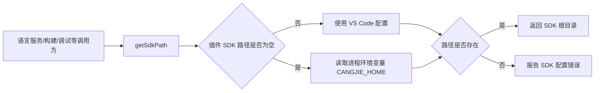

# VS Code 插件 SDK 目录支持 CANGJIE_HOME 环境变量

* CJEEP ID：
* Author(s)：u010808414
* Status：Reviewing
* Implementation：UnImplemented

> 关联 Issue：[Cangjie/UsersForum#3167](https://gitcode.com/Cangjie/UsersForum/issues/3167)

# 1、特性需求/问题/动机的来源与价值

## 1.1 需求来源

仓颉 VS Code 插件目前要求用户通过 `CangjieSdkPath.CJNativeBackend` 或
`CangjieSdkPath.CJVMBackend` 显式配置 SDK 根目录。VS Code Settings Sync 会在不同
设备间同步该值，而 Windows、Linux、macOS 上的安装路径通常不同，用户切换设备后需要
反复修改配置。

本特性在用户未配置插件 SDK 路径时，将进程环境变量 `CANGJIE_HOME` 作为 SDK 根目录
的回退来源。

## 1.2 用户价值

| 场景 | 实现前 | 实现后 |
| --- | --- | --- |
| 未配置插件路径，已设置 `CANGJIE_HOME` | 插件提示 SDK 路径未正确配置 | 插件使用 `CANGJIE_HOME` 启动语言服务、构建和调试能力 |
| 已配置有效插件路径 | 使用插件配置 | 行为不变，插件配置优先 |
| 已配置无效插件路径，同时环境变量有效 | 报告插件配置错误 | 行为不变，不使用环境变量掩盖错误配置 |
| 插件路径和环境变量均未设置 | 提示 SDK 路径未正确配置 | 提示用户配置插件路径或 `CANGJIE_HOME` |

该方案使每台设备可以通过本机环境变量维护 SDK 位置，避免 Settings Sync 同步绝对路径
造成的跨平台冲突。

# 2、特性影响分析

## 2.1 系统位置及周边接口



修改位于插件公共 SDK 路径解析逻辑。所有现有调用方继续通过 `getSdkPath()` 获取路径，
不新增调用方分支，不改变语言服务、构建、调试、格式化、静态检查等模块的接口。

## 2.2 环境依赖

* 支持 Windows、Linux 和 macOS，统一从 VS Code Extension Host 的
  `process.env.CANGJIE_HOME` 读取。
* `CANGJIE_HOME` 应指向与现有插件 SDK 路径配置相同层级的仓颉 SDK 根目录。
* 环境变量由 VS Code 启动时的宿主环境继承；修改环境变量后需要重新启动 VS Code，
  与其他进程环境变量的生效方式一致。
* 本特性同时适用于 CJNative 和 CJVM 后端。后端专属的插件路径配置仍分别解析；
  只有当前后端对应配置为空时才回退到 `CANGJIE_HOME`。

## 2.3 模块、依赖及关键约束

涉及模块：

1. 插件公共工具模块中的 `getSdkPath()`。
2. SDK 安装与配置文档。
3. SDK 路径解析单元测试或等价 DT 用例。

不引入第三方依赖。关键约束如下：

1. VS Code 配置的优先级始终高于环境变量。
2. 只有配置值为空时才允许回退，显式但无效的配置必须继续报错。
3. 返回值仍为 SDK 根目录字符串，调用方接口不变。
4. 沿用现有路径存在性校验规则，不在本特性中扩大 SDK 完整性校验范围。

## 2.4 兼容性和用户感知

本特性不修改仓颉语言、SDK、编译器、运行时的 API/ABI，也不修改 VS Code 配置键。
已配置 SDK 路径的用户行为完全不变。未配置路径且已有 `CANGJIE_HOME` 的用户会直接获得
可用的 SDK，这是新增的兼容行为；未设置环境变量的用户仍进入原有错误路径。

## 2.5 性能影响

每次解析 SDK 路径增加一次常量时间的环境变量读取，仅发生在插件侧控制流程中，对编译、
运行时性能和产物大小无实质影响。空间开销为常量级。

# 3、业界竞品分析（可选）

开发工具通常采用“显式工具配置优先、标准环境变量或 `PATH` 回退”的方式定位工具链。
这种顺序既允许项目或用户配置精确覆盖，又能复用操作系统已有的开发环境配置。

本方案不直接从 `PATH` 推断 SDK 根目录，因为可执行文件位置不足以稳定推导完整 SDK 结构；
使用语义明确的 `CANGJIE_HOME` 可以避免错误识别。

# 4、本特性的设计/实现方案

## 4.1 路径选择规则

```text
configuredPath = VS Code 当前后端对应的 SDK 路径配置

if configuredPath 非空:
    candidatePath = configuredPath
else:
    candidatePath = process.env.CANGJIE_HOME

if candidatePath 为空或路径不存在:
    报告 SDK 路径配置错误
else:
    返回 candidatePath
```

“非空”沿用当前 JavaScript/TypeScript 字符串判断语义。显式配置的空字符串等同于未配置；
空白字符串是显式值，路径校验失败，不回退环境变量。

## 4.2 配置优先级

| 优先级 | 来源 | 说明 |
| --- | --- | --- |
| 1 | `CangjieSdkPath.CJNativeBackend` 或 `CangjieSdkPath.CJVMBackend` | 由 VS Code 自动按语言、工作区、用户和默认配置规则解析 |
| 2 | `process.env.CANGJIE_HOME` | 仅当前后端的插件配置为空时读取 |
| 3 | 错误提示 | 两个来源均不可用时进入原有失败路径 |

## 4.3 错误处理

* 插件配置非空但路径不存在：继续报告配置路径无效，不回退。
* 插件配置为空且 `CANGJIE_HOME` 不存在：错误信息提示可配置插件路径或环境变量。
* 插件配置为空且 `CANGJIE_HOME` 指向不存在的路径：错误信息指出环境变量值无效。
* 不记录完整环境变量值到遥测或公共日志，避免暴露用户名、磁盘布局等本地信息。

## 4.4 方案对比

**方案 A：在公共 `getSdkPath()` 中回退（采用）**

优点：所有 SDK 消费方行为一致；改动集中；无需修改配置键或各业务模块。缺点：需要为公共
方法补充优先级和异常分支测试。

**方案 B：插件激活时把环境变量写入 VS Code 配置（不采用）**

缺点：会修改用户设置并可能被 Settings Sync 再次同步，违背解决跨设备路径冲突的目标；
还会混淆用户显式配置与自动发现值。

**方案 C：各语言服务、构建、调试模块分别回退（不采用）**

缺点：产生重复代码，不同能力可能选择不同 SDK，后续维护和测试成本高。

# 5、DFX 分析

| 维度 | 分析与措施 |
| --- | --- |
| 可诊断性 | 区分“未提供路径”和“环境变量路径无效”，同时保留显式配置错误不被回退掩盖 |
| 可维护性 | 仅在公共路径解析入口实现优先级，调用方零改动 |
| 可用性 | 多设备分别维护本机环境变量，Settings Sync 不再要求同步绝对路径 |
| 可测试性 | 将配置值、环境变量值和路径存在性作为可控输入，覆盖完整优先级矩阵 |
| 性能 | 一次环境变量读取，常量级开销 |

# 6、可信分析

* 安全性（Security）：不执行环境变量内容，只将其作为路径并经过现有存在性校验。
* 可靠性（Reliability）：显式配置优先，错误配置不会被环境变量静默掩盖。
* 韧性（Resilience）：环境变量缺失或无效时进入明确错误路径，不产生未捕获的空路径访问。
* 可用性（Availability）：不涉及服务可用性。
* 隐私（Privacy）：不新增遥测，不在公共日志输出完整本地路径。
* 无害（Safety）：不修改 SDK 内容、系统环境变量或用户 VS Code 设置。

# 7、关键 DT 用例简述

| 测试用例名称 | 预置条件 | 用例关键步骤 | 预期结果 |
| --- | --- | --- | --- |
| 显式配置优先 | 插件路径和 `CANGJIE_HOME` 均为不同的有效目录 | 调用 `getSdkPath()` | 返回插件路径 |
| 配置为空时回退 | 插件路径为空，`CANGJIE_HOME` 为有效目录 | 调用 `getSdkPath()` | 返回环境变量路径 |
| 显式配置错误不回退 | 插件路径不存在，环境变量路径有效 | 调用 `getSdkPath()` | 报告插件配置错误 |
| 两个来源均未设置 | 插件路径为空，删除测试进程中的 `CANGJIE_HOME` | 调用 `getSdkPath()` | 报告可操作的 SDK 配置错误 |
| 环境变量路径无效 | 插件路径为空，环境变量指向不存在目录 | 调用 `getSdkPath()` | 报告 `CANGJIE_HOME` 无效 |
| CJNative 回退 | 当前后端为 CJNative，CJNative 路径为空，环境变量有效 | 启动语言服务并执行一次构建 | 语言服务和构建使用环境变量 SDK |
| CJVM 回退 | Linux 上当前后端为 CJVM，CJVM 路径为空，环境变量有效 | 启动对应能力 | 使用环境变量 SDK |
| Windows 路径 | Windows 环境变量包含空格和反斜杠 | 启动语言服务、构建和调试 | 路径不被错误拆分或改写 |
| Linux/macOS 路径 | 环境变量为 POSIX 绝对路径 | 启动语言服务、构建和调试 | 正确使用该 SDK |
| 后端切换回归 | 两个后端配置均存在且不同 | 切换后端并分别调用 | 始终使用当前后端的显式配置 |

测试需要在每个用例后恢复原始 `process.env.CANGJIE_HOME`，避免进程级状态污染其他用例。

# 8、结论

本方案在仓颉 VS Code 插件公共 `getSdkPath()` 中增加 `CANGJIE_HOME` 回退来源，遵循
“当前后端显式配置 > 环境变量 > 错误”的固定顺序。方案不修改现有配置键或调用方接口，
不写入用户设置，兼容已配置用户，并解决 Settings Sync 在多平台同步绝对路径的问题。

待 Team 评审确认以下事项：

1. `CANGJIE_HOME` 是否同时作为 CJNative 和 CJVM 的统一回退变量。
2. 环境变量无效时的错误文案是否需要区分来源。
3. 插件实现源码开放方式及目标开发分支。

# 附录

## 一、可测试性设计（建议组内评审）

建议将“读取 VS Code 配置”“读取环境变量”“判断路径存在”封装为可替换依赖，或在单元测试中
分别 stub，以稳定覆盖优先级矩阵。集成测试至少覆盖 Windows 和一种 POSIX 平台，并验证语言
服务、构建、调试三个主要调用链使用同一 SDK 根目录。

## 二、评审范围

本特性属于 IDE 工具链用户可感知的配置解析行为变化，涉及多个操作系统，但不修改语言、SDK
或公共 API/ABI。建议由 Team IDE 完成功能方案评审；是否需要进入架构会议由 Team Leader 和
PMC System Designer 判定。
