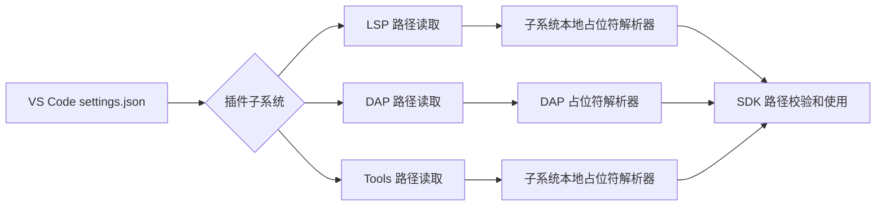
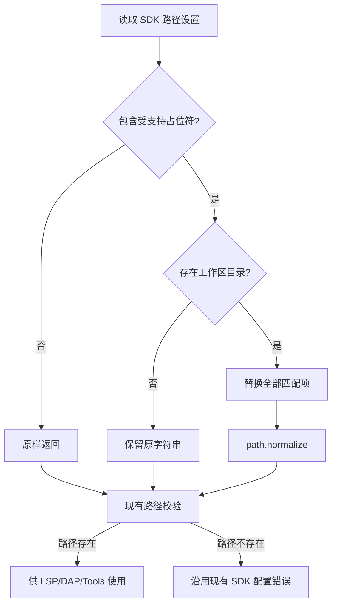

# VSCode 插件 SDK 路径工作区占位符支持

* CJEEP ID：CJEEP-0007
* Author(s)：candy
* Status：Reviewing
* Implementation：UnImplemented

# 1、特性需求/问题/动机的来源与价值

本提案来源于 [Cangjie/UsersForum#3038](https://gitcode.com/Cangjie/UsersForum/issues/3038)，并作为仓颉开源社区学习赛第二批高级任务发布。

当前仓颉 VS Code 插件要求用户在 `CangjieSdkPath.CJNativeBackend` 或 `CangjieSdkPath.CJVMBackend` 中配置 SDK 的绝对路径。项目在不同开发机、容器或 Remote SSH 环境之间迁移时，绝对路径通常不同，因此开发者需要反复修改 `.vscode/settings.json`，或者额外修改系统环境变量。

本特性支持在 SDK 路径设置中使用 VS Code 通用写法 `${workspaceFolder}`，并兼容活动任务清单中的 `${workspace}` 写法。例如：

```json
{
  "CangjieSdkPath.CJNativeBackend": "${workspaceFolder}/../cangjie"
}
```

插件消费该设置时，将占位符替换为当前第一个工作区目录。项目可以将相对工作区的 SDK 布局提交到版本库，在本地与远程环境复用同一份配置，且无需修改系统环境。

# 2、特性影响分析

## 2.1 系统位置与数据流



该特性位于插件配置读取与现有 SDK 路径校验之间。插件不修改 VS Code 配置，只在内存中解析读取到的字符串。

## 2.2 环境与模块依赖

特性同时影响 CJNative、CJVM 两个后端，以及 Windows、Linux、macOS 三个平台。实现仅依赖 VS Code 的 `workspace.workspaceFolders` API 和 Node.js `path` 模块，不增加第三方依赖。

仓库中的 LSP、DAP、Tools 可以独立构建，因此三个子系统各自保留一个小型纯解析器；DAP 的两个 SDK 路径入口共用同一解析器。解析规则保持一致，并由同一组契约测试验证。

## 2.3 兼容性与用户感知

本特性不修改公开 API、ABI、配置项名称或默认值。原有绝对路径在不包含占位符时原样返回，行为保持不变。包含占位符的配置属于新增能力，用户可以直接感知。

暂不支持 `${workspaceFolder:name}` 命名多工作区语法。仓库已有行为均使用第一个工作区目录，本特性沿用该规则，避免与单工作区多文件夹语言服务任务产生范围冲突。

## 2.4 性能影响

解析只在读取 SDK 设置时对一个短字符串执行包含判断、替换和路径规范化，时间复杂度为 O(n)，n 为设置字符串长度；除结果字符串外不保留额外状态。相对于文件系统校验和进程启动，时间与空间开销可以忽略。

# 3、业界竞品分析（可选）

VS Code 的任务、调试配置和终端配置普遍使用 `${workspaceFolder}` 表示当前工作区目录。扩展设置的变量替换并非由 VS Code 自动应用，扩展需要在消费设置时自行解析。本方案沿用用户熟悉的变量名称，并将解析范围限制在仓颉 SDK 路径设置中。

# 4、本特性的设计/实现方案

## 4.1 用户接口

支持以下设置：

* `CangjieSdkPath.CJNativeBackend`
* `CangjieSdkPath.CJVMBackend`

支持以下精确、区分大小写的占位符：

* `${workspaceFolder}`：推荐并写入设置说明。
* `${workspace}`：兼容社区学习赛任务清单。

字符串中每个匹配项都会被替换为 `workspace.workspaceFolders[0].uri.fsPath`。只有发生替换时，才使用 Node.js `path.normalize` 按当前平台规范化结果。未包含占位符的值原样返回。

## 4.2 正常与异常流程



没有打开工作区时不具备替换依据，解析器保留原字符串，后续现有文件系统校验会产生当前统一错误：

```text
The Cangjie SDK path has not been configured properly. Please configure it first.
```

## 4.3 源文件变更

新增三个纯解析器：

* `src/lsp/src/utils/sdk-path-utils.ts`
* `src/dap/src/sdk-path-utils.ts`
* `src/tools/src/util/sdk-path-utils.ts`

修改四个读取入口：

* `src/lsp/src/utils/utils.ts` 中的 `Utility.getCangjieHome`。
* `src/dap/src/common-utils.ts` 中的 `getSdkPath`。
* `src/dap/src/cangjie-env-configuration.ts` 中的 `generateSdkPath`。
* `src/tools/src/util/utils.ts` 中的 `Utility.getCangjieHome`。

同时更新根 `package.json` 与 `src/dap/package.json` 中两个 SDK 设置项的说明，并增加解析器契约测试和 DAP 集成测试。

## 4.4 方案比较

方案一是在四个读取入口调用各子系统本地纯解析器。优点是改动范围小、不改变独立构建边界、容易测试；缺点是三个解析器存在少量重复。本文采用该方案。

方案二是建立跨 LSP、DAP、Tools 的共享模块。优点是实现集中；缺点是会引入跨子项目依赖，影响现有独立构建和发布方式。

方案三是在插件启动时遍历并改写 VS Code 设置。优点是后续读取无需处理；缺点是会修改用户配置、扩大影响范围，并可能造成远程与本地配置互相覆盖，因此不采用。

# 5、DFX 分析

* 可诊断性：路径解析后继续使用现有路径存在性校验和统一错误信息，不引入新的静默降级。
* 可维护性：解析器为无状态纯函数，输入输出明确；三个副本由同一组契约测试约束。
* 可扩展性：未来若支持命名多工作区，可在解析函数中增加明确语法，而无需修改 SDK 使用方。
* 故障隔离：仅 SDK 路径设置进入解析流程，其他插件设置不受影响。

# 6、可信分析

* Security：不执行设置字符串中的命令，不读取 SDK 路径之外的文件内容；替换结果仍经过现有路径校验。
* Reliability：无工作区、空设置和不存在路径继续进入现有错误路径；普通绝对路径行为不变。
* Resilience：解析不依赖网络或外部服务，失败不会修改持久化配置。
* Availability：功能仅增加本地字符串处理，不影响插件启动与现有绝对路径用户。
* Privacy：不收集、记录或发送工作区路径及其他用户信息。
* Safety：不写入 `settings.json`，不修改系统环境变量和文件系统内容。

# 7、关键 DT 用例简述

| 测试用例名称 | 预置条件 | 用例关键步骤 | 预期结果 |
| - | - | - | - |
| 推荐占位符解析 | 已打开单工作区 | 配置 `${workspaceFolder}/../cangjie` 并读取 SDK 路径 | 替换为第一个工作区目录并按当前平台规范化 |
| 兼容占位符解析 | 已打开单工作区 | 配置 `${workspace}/sdk` 并读取 SDK 路径 | `${workspace}` 被正确替换 |
| 多次占位符解析 | 已打开单工作区 | 在同一设置中放入多个受支持占位符 | 所有匹配项均被替换 |
| 普通绝对路径 | 已配置有效绝对路径 | 读取 SDK 路径 | 返回值与原配置完全一致 |
| 未打开工作区 | 工作区列表为空 | 配置含占位符的 SDK 路径 | 沿用现有 SDK 路径配置错误 |
| 替换后路径不存在 | 工作区已打开 | 配置指向不存在位置的相对路径 | 沿用现有 SDK 路径配置错误 |
| CJNative 后端 | 选择 CJNative | 读取并使用含占位符路径 | LSP、DAP、Tools 获得解析后的路径 |
| CJVM 后端 | 选择 CJVM | 读取并使用含占位符路径 | LSP、DAP、Tools 获得解析后的路径 |
| 跨平台路径 | 分别在 Windows、Linux、macOS 执行测试 | 解析工作区相对 SDK 路径 | 使用对应平台的规范路径分隔符 |

# 8、结论

本提案选择在 LSP、DAP、Tools 的 SDK 设置读取边界解析 `${workspaceFolder}` 和 `${workspace}`，沿用第一个工作区目录规则，不修改用户配置，不改变普通绝对路径行为。该方案改动局部、兼容性风险低，并可通过纯函数契约测试、DAP 集成测试和插件构建验证。

本提案编号为 CJEEP-0005，当前状态为 Reviewing，待 IDE Team 完成方案评审。

# 附录

## 一、可测试性设计

解析逻辑采用纯函数，直接验证输入字符串、工作区路径与输出路径。集成测试控制 VS Code 工作区 mock 与文件系统存在性判断，验证解析发生在路径校验之前。根插件 webpack 构建覆盖三个子系统的实际打包边界，lint 用于确认没有新增静态检查告警。

## 二、评审范围

该特性是用户可感知的 IDE 配置能力变更，影响 LSP、DAP、Tools 三个插件子系统及两个 SDK 后端，建议由 IDE Team 完成功能实现方案评审。它不修改仓颉语言、编译流程、公开 API 或 ABI。
