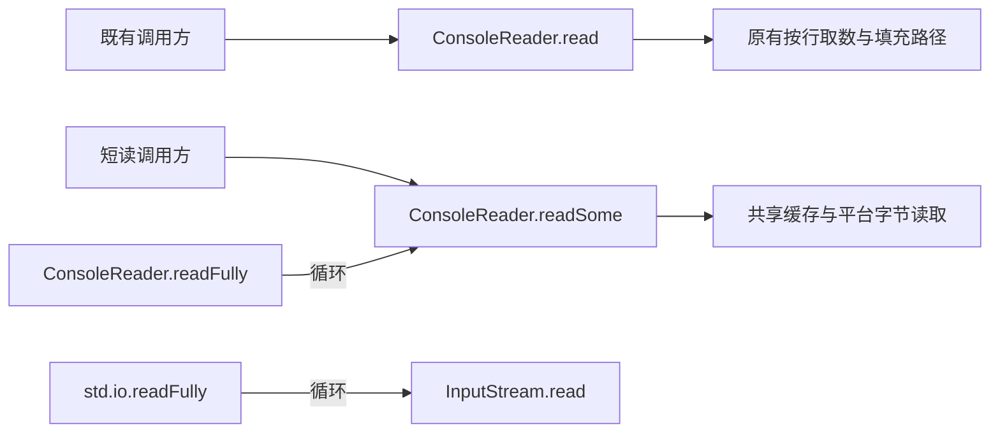

# 标准输入短读与显式读满

* CJEEP ID：待分配
* Author(s)：HenonBamboo（@HenonBamboo_YYJ）
* Status：Reviewing
* Implementation：[runtime !1641](https://atomgit.com/Cangjie/cangjie_runtime/merge_requests/1641)、[docs !617](https://atomgit.com/Cangjie/cangjie_docs/merge_requests/617)、[test !1943](https://atomgit.com/Cangjie/cangjie_test/merge_requests/1943)。配套 PR 按本方案修订实现、文档和回归。

# 1、特性需求/问题/动机的来源与价值

来源：[runtime issue #596](https://atomgit.com/Cangjie/cangjie_runtime/issues/596) 及 [PR !1641](https://atomgit.com/Cangjie/cangjie_runtime/merge_requests/1641)。

`std.env.ConsoleReader.read(Array<Byte>)` 当前按行取数并尝试填满数组。在管道请求—应答场景中，写端发送少量数据后等待响应，读端等待换行或数组填满，可能造成双方互等。

本方案保留原有 `ConsoleReader.read` 行为，新增允许短读的 `readSome`，由调用方主动选择；同时提供显式读满能力，分别满足流式读取和固定长度读取需求。旧 `read` 在输入结束或读取失败时仍可返回不足长度，与“填满才成功”的严格读满操作不同。

# 2、特性影响分析

- 涉及模块：`std.env`、`std.io`、`std.core` 原生输入层，以及配套文档和测试。
- 平台：Windows 重定向输入使用 `ReadFile`，旧行读取路径保留默认文本语义（CRLF 转为 LF，`0x1A` 作为 EOF），独立使用 `readSome` 则保留原始字节；字符设备保留宽字符读取。POSIX 使用 `read`。
- 行为兼容：保留 `ConsoleReader.read` 的签名和原有按行取数、尝试填满行为，不废弃旧接口。短读由新方法 `readSome` 提供，现有调用方不因新增能力而自动切换读取语义。
- API/ABI：`InputStream` 保持原有成员结构，不新增默认 `readFully`。新增 `ConsoleReader.readSome`、`ConsoleReader.readFully` 和 `std.io.readFully` 顶层函数。避免新增接口默认成员这一已知 ABI 风险，不等于整项变更已获得二进制兼容性证明；新增类成员、原生实现及预编译依赖仍需完成兼容性检查。
- 性能：原生层增加固定 512 字节共享缓存；读满循环使用数组切片，不增加等长中间缓冲区。

# 3、业界竞品分析

Java [DataInput.readFully](https://docs.oracle.com/en/java/javase/25/docs/api/java.base/java/io/DataInput.html#readFully(byte%5B%5D))、Rust [Read.read_exact](https://doc.rust-lang.org/std/io/trait.Read.html#method.read_exact) 均提供显式读满能力。Go [io.ReadFull](https://pkg.go.dev/io#ReadFull) 使用独立函数；Boost.Asio [read](https://www.boost.org/doc/libs/latest/doc/html/boost_asio/reference/read/overload1.html) 在底层 `read_some` 之上组合读取。这些方案均区分基础读取与严格读满，公开接口可以采用方法或独立函数。本方案结合既有接口的兼容性约束，在标准输入具体类型上提供短读与读满方法，并以顶层函数服务通用输入流。

# 4、本特性的设计/实现方案

## 4.1 标准输入读取



`ConsoleReader.read` 保留原有循环：从按行读取路径获取数据，尝试填满数组；输入结束或读取失败时返回已取得的有效前缀。该方法可能等待换行，不用于保证管道请求—应答场景的及时返回。

新增方法：

```cangjie
public func readSome(arr: Array<Byte>): Int64
```

1. 空数组直接返回 0；已有缓存时复制可用数据并返回实际计数，不继续等待新数据填满数组。
2. 重定向输入使用平台字节读取，不要求换行，也不等待数组填满或写端关闭。没有数据时仍可阻塞；交互终端继续受终端输入模式影响。
3. 原生行读取与字节读取共享缓存并加锁，避免绕过预取数据；同一 `ConsoleReader` 内混用新旧方法保持消费顺序。Windows 下，若 `read`、`readln` 或 `readUntil` 已将数据预取到该实例缓存，`readSome` 会先取得已经过文本转换的剩余数据，不能保证混用仍保持输入原始字节。需要原始字节的协议应从开始就使用 `readSome` 或基于它的 `readFully`。POSIX 遇 EINTR 重试，Windows 断管按 EOF 处理。

共享原生缓存不等于共享所有上层缓存，不承诺任意交替 `ConsoleReader` 和 `std.core` 行读取的全局顺序；也不承诺与外部 CRT `getchar`、`_setmode` 或 `freopen` 混用的兼容性。

`InputStream.read` 的通用契约仍允许短读，具体实现可以尝试填满。短读不表示 EOF；调用方只处理返回计数对应的前缀。`ConsoleReader` 的读取失败也可能返回 0，`readSome` 保留这一限制并明确说明，不能将 0 解释为所有情况下都只有正常 EOF。

## 4.2 显式读满

在 `ConsoleReader` 中新增方法：

```cangjie
public func readFully(buffer: Array<Byte>): Unit
```

该方法循环调用 `this.readSome`，每次读取剩余切片。在重定向管道中，收齐目标字节即可完成，不要求换行或写端关闭。

在 `std.io` 中新增顶层函数：

```cangjie
public func readFully(from: InputStream, buffer: Array<Byte>): Unit
```

顶层函数循环调用 `from.read`，供文件、内存、自定义及组合输入流使用，不要求实现类新增接口成员。它继承底层 `read` 的等待方式；若传入 `ConsoleReader`，仍可能等待换行。需要通过标准输入短读路径读满时，调用 `getStdIn().readFully(buffer)`，不能用通用函数代替并承诺相同的返回时机。

两种入口具有相同的完成与失败约定：

- 填满后返回；空数组不调用底层读取。
- 未满时返回 0，或返回计数超出请求范围，抛 `IOException`。
- 底层异常原样传播；失败后数组可能部分写入。

两种入口均不关闭流，多次读取不保证整体互斥，也不提供超时、取消或消息边界识别。调用方须协调同一输入流上的其他消费者。底层将错误映射为 0 时，只能报告未填满，不能恢复已经丢失的错误原因。

同步中英文 API、用户指南及回归用例。实现涉及 `console_reader.cj`、`env/native.cj`、`core/native/console_read.c` 和 `io/io_utils.cj`；`io/stream.cj` 保留原有接口成员结构。

# 5、DFX分析

提前结束时报告目标长度和已读长度，底层异常原样传播，便于定位输入不足或读取失败。

# 6、可信分析

剩余切片限定每次请求长度，并校验返回计数；使用锁保护原生共享缓存。新增异常信息不包含输入内容。

# 7、关键DT用例简述

| 测试用例 | 预置条件 | 关键步骤 | 预期结果 |
| --- | --- | --- | --- |
| 旧读取兼容 | 分行输入、提前 EOF 或缓存剩余 | 直接或通过 InputStream 调用 read | 保持按行取数、尝试填满及不足长度返回行为 |
| 管道短读 | 写端保持打开 | 分别发送有、无换行的少量数据并调用 readSome | 数组未满时返回有效前缀 |
| 延迟输入与 EOF | 初始无数据或输入已结束 | 等待后发送数据，或关闭写端 | 不误报 EOF；结束时返回 0 |
| 缓存混读 | 同一个 ConsoleReader | 交替调用 read、readSome、readUntil 和 readln | 按消费顺序返回；Windows 行路径预取部分保留文本转换结果，不保证混用时原始字节不变 |
| 原生缓存衔接 | ConsoleReader 自身无剩余缓存 | 按 readSome → std.core.readln → readSome 的顺序读取 | 已验证序列不绕过原生预取数据；不承诺任意跨层混读 |
| 标准输入读满 | 无换行的输入分段到达 | 调用 ConsoleReader.readFully，随后补齐或关闭输入 | 收齐即成功，提前结束抛异常 |
| 通用读满与边界 | 空数组、切片、自定义及组合流 | 调用顶层 readFully，验证异常、非法计数及未读数据保留 | 严格完成，继承底层等待方式，原接口实现仍可使用 |
| 平台与 ABI | Windows、POSIX 及预编译依赖 | 验证终端、管道、文件、CRLF、缓存边界及兼容性探针 | 明确各平台与二进制兼容性覆盖范围 |

本轮使用 Windows x64 1.1.3、Linux x64 1.2.0 的任务私有 SDK，覆盖本轮 `std.io`、`std.env` 及原生标准输入实现后完成专项验证：读满契约、6 个管道案例（实例方法与适配器各 3 个）、短读、旧 `read` 等待与 EOF、新旧混读，以及 Windows CRLF、`Ctrl+Z` 和 512 字节缓存边界均通过。Linux POSIX PTY 验证通过，Windows 真实终端未验证。10 个完整文档示例在 Linux 编译运行通过；两平台的旧实现库与旧可执行文件兼容性探针通过。这些结果属于专项覆盖验证，不代表源版本 1.3 的完整 SDK 构建、正式 ABI 检查或全部 CI 门禁已通过。

# 8、结论

待评审确认保留旧 `read`、新增 `ConsoleReader.readSome/readFully` 及 `std.io.readFully` 顶层函数的设计，并依据配套验证结果确定发布方式。
