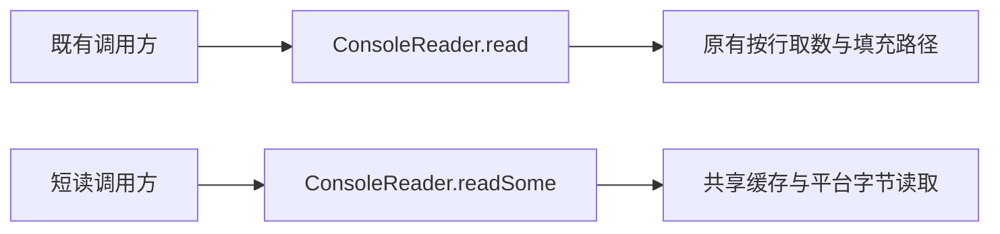

# 标准输入短读 API

* CJEEP ID：CJEEP-0010
* Author(s)：HenonBamboo（@HenonBamboo_YYJ）
* Status：Reviewing
* Implementation：[runtime !1641](https://atomgit.com/Cangjie/cangjie_runtime/merge_requests/1641)、[docs !617](https://atomgit.com/Cangjie/cangjie_docs/merge_requests/617)、[test !1943](https://atomgit.com/Cangjie/cangjie_test/merge_requests/1943)。配套 PR 按本方案修订实现、文档和回归。

# 1、特性需求/问题/动机的来源与价值

来源：[runtime issue #596](https://atomgit.com/Cangjie/cangjie_runtime/issues/596) 及 [PR !1641](https://atomgit.com/Cangjie/cangjie_runtime/merge_requests/1641)。

`std.env.ConsoleReader.read(Array<Byte>)` 当前按行取数并尝试填满数组。在管道请求—应答场景中，写端发送少量数据后等待响应，读端等待换行或数组填满，可能造成双方互等。

本方案保留原有 `ConsoleReader.read` 行为，新增允许短读的 `readSome`，由调用方主动选择，满足标准输入的流式读取需求。旧 `read` 在输入结束或读取失败时仍可返回不足长度；使用新方法的调用方按返回计数处理有效前缀，并按协议自行累计数据。

## 1.1、管道请求—应答的最小复现

父进程发送请求并 flush 后保持子进程的 stdin 打开，等待子进程返回响应；子进程先读取 stdin，再发送响应。当读取条件尚未满足时，双方会等待对方先行动：

```text
父进程：发送请求 → 等待 ACK → 才发送下一条请求
子进程：等待换行或填满数组 → 才发送 ACK
```

下面用两个独立用例区分等待条件，目标数组均为 8 字节：

| 用例 | 父进程首次发送 | 旧 read 尚未满足的条件 | readSome 的预期行为 |
| --- | --- | --- | --- |
| line | `abcdefgh`（8 字节，无换行） | 底层按行读取仍需换行或 EOF，即使已有 8 字节也可能等待 | 允许返回已取得的字节，不要求换行 |
| fill | `abc\n`（4 字节，有换行） | 上层继续尝试填满数组，等待下一行或 EOF | 允许返回不足 8 字节的数据 |

保存以下子进程为 `stdin_request.cj`。它只在启动时读取一次环境变量，以便用同一个可执行文件比较两种接口；`ACK` 中打印实际计数和有效字节，避免依赖字符串解码或完整消息边界。

```cangjie
import std.env.getStdIn
import std.env.getVariable

main() {
    let useShortRead = getVariable("CJEEP0010_MODE") == Some("some")
    let buffer = Array<Byte>(8, repeat: 0)
    print("READY\n", flush: true)
    let count = if (useShortRead) {
        getStdIn().readSome(buffer)
    } else {
        getStdIn().read(buffer)
    }
    print("ACK:${count}:${buffer[..count]}\n", flush: true)
}
```

保存以下父进程为 `check_request.py`，使用 Python 3 运行。它在收到 `READY` 后才发送请求，观察旧接口 1 秒内是否没有响应且进程仍存活，再补充满足读取条件的数据，确认子进程能够继续执行。新接口必须在写端仍打开时响应。每条路径均检查响应字节、子进程退出码，并在异常时终止、回收子进程。

```python
import ast
import os
from pathlib import Path
import queue
import subprocess
import sys
import threading


def collect_lines(stream, events):
    try:
        for line in iter(stream.readline, b""):
            events.put(line)
    finally:
        events.put(None)


def receive(events, timeout=5):
    line = events.get(timeout=timeout)
    if line is None:
        raise AssertionError("child stdout closed before ACK")
    return line.rstrip(b"\r\n")


def check(binary, mode, label, payload, release):
    env = dict(os.environ, CJEEP0010_MODE=mode)
    child = subprocess.Popen(
        [binary], stdin=subprocess.PIPE, stdout=subprocess.PIPE,
        stderr=subprocess.PIPE, env=env,
    )
    events = queue.Queue()
    errors = []
    reader = threading.Thread(target=collect_lines,
                              args=(child.stdout, events), daemon=True)
    error_reader = threading.Thread(
        target=lambda: errors.append(child.stderr.read()), daemon=True)
    reader.start()
    error_reader.start()
    try:
        if receive(events) != b"READY":
            raise AssertionError("missing READY handshake")
        child.stdin.write(payload)
        child.stdin.flush()
        if mode == "read":
            try:
                unexpected = receive(events, timeout=1)
            except queue.Empty:
                if child.poll() is not None:
                    raise AssertionError("child exited during observation")
            else:
                raise AssertionError(f"unexpected early response: {unexpected!r}")
            print(f"{mode}/{label}: no ACK in 1s; writer open", flush=True)
            child.stdin.write(release)
            child.stdin.flush()
        ack = receive(events)
        tag, count_text, data_text = ack.decode("ascii").split(":", 2)
        count = int(count_text)
        data = bytes(ast.literal_eval(data_text))
        if tag != "ACK" or count != len(data):
            raise AssertionError(f"invalid response: {ack!r}")
        if mode == "read":
            if count != 8 or data != (payload + release)[:8]:
                raise AssertionError(f"legacy read mismatch: {ack!r}")
        elif not (0 < count <= min(8, len(payload)) and data == payload[:count]):
            raise AssertionError(f"short read mismatch: {ack!r}")
        # Keep stdin open even while waiting for the child to exit.
        if child.wait(timeout=5) != 0:
            raise AssertionError("child returned a nonzero exit code")
        reader.join(timeout=5)
        error_reader.join(timeout=5)
        if reader.is_alive() or error_reader.is_alive():
            raise AssertionError("output collection did not finish")
        if errors != [b""] or events.get_nowait() is not None or not events.empty():
            raise AssertionError(f"unexpected additional output: {errors!r}")
        print(f"{mode}/{label}: {ack.decode('ascii')}; writer open", flush=True)
    finally:
        if child.poll() is None:
            child.kill()
        child.wait(timeout=5)
        reader.join(timeout=5)
        error_reader.join(timeout=5)
        child.stdin.close()
        child.stdout.close()
        child.stderr.close()


if __name__ == "__main__":
    if len(sys.argv) != 2:
        raise SystemExit("usage: python check_request.py <stdin_request executable>")
    executable = str(Path(sys.argv[1]).resolve(strict=True))
    for name, request, continuation in [
        ("line", b"abcdefgh", b"\n"),
        ("fill", b"abc\n", b"def\n"),
    ]:
        for method in ("read", "some"):
            check(executable, method, name, request, continuation)
    print("PASS: 4 pipe cases")
```

在包含本提案实现的 SDK 环境中编译运行（未包含 `readSome` 的发行版 SDK 不能直接编译此示例）。编译器、模块搜索路径和动态库加载路径必须指向同一套 SDK；`--dy-std` 用于本次动态标准库验证。

Windows PowerShell：

```powershell
cjc stdin_request.cj --dy-std -o stdin_request.exe
python check_request.py ./stdin_request.exe
```

Linux：

```sh
cjc stdin_request.cj --dy-std -o stdin_request
python3 check_request.py ./stdin_request
```

不能用会主动关闭 stdin 的一次性输入代替此驱动，例如 `subprocess.run(input=...)`：EOF 会解除旧读取的等待，不能复现持续连接上的请求—应答关系。1 秒观察窗口不是对线程调度或永久死锁的证明；`READY`、存活检查、补充输入后恢复及源码中的读取条件共同说明等待原因。上述示例已实际编译运行，4 个管道用例通过。

# 2、特性影响分析

- 涉及模块：`std.env`、`std.core` 原生输入层，以及 `std.io.InputStream.read` 契约说明、配套文档和测试。
- 平台：Windows 重定向输入使用 `ReadFile`，旧行读取路径保留默认文本语义（CRLF 转为 LF，`0x1A` 作为 EOF），独立使用 `readSome` 则保留原始字节；字符设备保留宽字符读取。POSIX 使用 `read`。
- 行为兼容：保留 `ConsoleReader.read` 的签名和原有按行取数、尝试填满行为，不废弃旧接口。短读由新方法 `readSome` 提供，现有调用方不因新增能力而自动切换读取语义。
- API/ABI：仅新增 `ConsoleReader.readSome`；`InputStream` 保持原有成员结构。保持接口结构不等于整项变更已获得二进制兼容性证明；新增类成员、原生实现及预编译依赖仍需完成兼容性检查。
- 性能：原生层增加固定 512 字节共享缓存，已有缓存时直接复制可用数据，不继续等待填满调用方数组。

## 2.1、其他 I/O 接口的等待条件与本提案边界

双方互等并非 `ConsoleReader` 独有。是否发生互等取决于读取操作的返回条件与对端协议的发送条件：一端等待换行、更多字节或 EOF，另一端等待响应后才继续发送，就可能形成循环等待。阻塞读取本身不等于实现缺陷。

以下依据当前实现分析其他 I/O 接口的等待条件。路径均相对于运行时仓库的 `stdlib/libs/std/`。

| 接口/场景 | 源码中的返回条件 | 对请求—应答的影响 | 定位 |
| --- | --- | --- | --- |
| `ConsoleReader.read` | 按行获取输入并尝试填满数组，输入结束或行读取失败时可返回不足长度 | 换行条件和填充条件均可能与对端等待响应形成互等 | `env/console_reader.cj`：`read`、`readFromConsole` |
| `BufferedInputStream.read` | 自身通过循环尝试填满数组；缓冲区耗尽时再次调用底层 `read` | 即使底层允许短读，包装层也可能继续等待更多数据 | `io/buffered_input_stream.cj`：`read`、`fillInBuf` |
| `TcpSocket.read` | 取得一批数据即可返回；无数据时等待，可受读取超时控制 | 没有上述按行和填充循环，但双方都先读、或调用方自行累计固定长度时仍可能互等 | `net/tcp.cj`：`read`；`net/socket_ffi_cjnative_impl.cj`：`readImpl`、`readSlowpath` |
| 子进程 stdout/stderr 管道的 `read` | 包装层转发，管道层单次底层读取，允许短读；无数据时可等待 | 不要求收到换行或填满数组，但不能替代协议的发送顺序设计 | `process/process_stream.cj`：`ProcessInputStream.read`、`PipeInputStream.read`；`process/native/process_ffi_{unix,win}.c` |
| `StringReader.readln/readUntil/readToEnd` | 分别读取到行结束、谓词满足或流结束，仍受底层流约束 | 对端等待响应而不提供相应结束条件时，可能互等；这是接口语义与协议不匹配 | `io/string_reader.cj`：对应方法及 `readUntilToString` |
| `SubProcess.waitOutput()` | 收集 stdout/stderr 到结束并等待子进程退出 | 子进程等待下一条请求而父进程等待完整输出时，可能互等 | `process/sub_process.cj`：`subProcessWaitOutput`；`process/process_utils.cj`：`readToByteBuffer` |
| 普通文件 `File.read` | 仓颉层调用底层读取；Unix 单次 `read`，Windows 大读取分块、短读即停止 | 普通文件通常不涉及对端等待响应；此结论不推广到 FIFO、设备等输入源 | `fs/file.cj`：`read`、`directRead`；`fs/native/file_system_{unix,win}.c`：`CJ_FS_FileRead` |
| `ByteBuffer.read` | 从已有内存数据复制不超过目标容量的字节，数据为空时返回 0 | 不等待外部生产者 | `io/byte_buffer.cj`：`read` |

尤其需要注意：`BufferedInputStream(getStdIn())` 调用的仍是旧 `read`，不会自动选用 `readSome`；即使编写适配器将底层 `read` 转发给 `readSome`，外层 `BufferedInputStream.read` 的填充循环仍可能继续读取并等待。`InputStream.read` 的通用契约允许具体实现选择短读或尝试填满，不能据此推导所有包装层都会短读返回。

本次仅为 `ConsoleReader` 增加可主动选择的短读入口，不改变其他既有 I/O 接口。`readSome` 不保证无数据时立即返回，不保证单次取得完整消息，也不保证终端逐键返回；调用方仍需处理实际计数、消息边界和请求—应答顺序。若后续希望扩展缓冲流等接口，应单独评估其契约与兼容性，不在本提案中隐式修改。

# 3、业界竞品分析

Java [InputStream.read](https://docs.oracle.com/en/java/javase/25/docs/api/java.base/java/io/InputStream.html#read(byte%5B%5D))、Rust [Read.read](https://doc.rust-lang.org/std/io/trait.Read.html#method.read) 均允许单次读取少于目标缓冲区容量的数据，由调用方依据实际计数处理结果。允许短读不代表非阻塞。本方案结合既有接口的兼容性约束，以新方法 `readSome` 提供短读能力，保留旧 `read` 的等待与填充行为。

# 4、本特性的设计/实现方案



`ConsoleReader.read` 保留原有循环：从按行读取路径获取数据，尝试填满数组；输入结束或读取失败时返回已取得的有效前缀。该方法可能等待换行，不用于保证管道请求—应答场景的及时返回。

新增方法：

```cangjie
public func readSome(arr: Array<Byte>): Int64
```

1. 空数组直接返回 0；已有缓存时复制可用数据并返回实际计数，不继续等待新数据填满数组。
2. 重定向输入使用平台字节读取，不要求换行，也不等待数组填满或写端关闭。没有数据时仍可阻塞；交互终端继续受终端输入模式影响。
3. 原生行读取与字节读取共享缓存并加锁，避免绕过预取数据；同一 `ConsoleReader` 内混用新旧方法保持消费顺序。Windows 下，若 `read`、`readln` 或 `readUntil` 已将数据预取到该实例缓存，`readSome` 会先取得已经过文本转换的剩余数据，不能保证混用仍保持输入原始字节。需要原始字节的协议应从开始就使用 `readSome`。POSIX 遇 EINTR 重试，Windows 断管按 EOF 处理。

共享原生缓存不等于共享所有上层缓存，不承诺任意交替 `ConsoleReader` 和 `std.core` 行读取的全局顺序；也不承诺与外部 CRT `getchar`、`_setmode` 或 `freopen` 混用的兼容性。

`InputStream.read` 的通用契约仍允许短读，具体实现可以尝试填满。短读不表示 EOF；调用方只处理返回计数对应的前缀。`ConsoleReader` 的读取失败也可能返回 0，`readSome` 保留这一限制并明确说明，不能将 0 解释为所有情况下都只有正常 EOF。

同步中英文 API、用户指南及回归用例。实现涉及 `console_reader.cj`、`env/native.cj` 和 `core/native/console_read.c`；`io/stream.cj` 保留原有接口成员结构。

# 5、DFX分析

返回实际读取字节数，调用方只处理有效前缀。部分底层读取失败仍映射为 0，本方案不改变这一既有错误处理方式，也不新增错误诊断保证。

# 6、可信分析

读取长度受目标数组容量限制，未写入部分保持不变；使用锁保护实例缓冲区及原生共享缓存。短读不识别消息边界，按字节分块可能截断 UTF-8 字符，调用方需按协议累计数据并处理字符边界。

# 7、关键DT用例简述

| 测试用例 | 预置条件 | 关键步骤 | 预期结果 |
| --- | --- | --- | --- |
| 旧读取兼容 | 分行输入、提前 EOF 或缓存剩余 | 直接或通过 InputStream 调用 read | 保持按行取数、尝试填满及不足长度返回行为 |
| 管道短读 | 写端保持打开 | 分别发送有、无换行的少量数据并调用 readSome | 数组未满时返回有效前缀 |
| 延迟输入与 EOF | 初始无数据或输入已结束 | 等待后发送数据，或关闭写端 | 不误报 EOF；结束时返回 0 |
| 缓存混读 | 同一个 ConsoleReader | 交替调用 read、readSome、readUntil 和 readln | 按消费顺序返回；Windows 行路径预取部分保留文本转换结果，不保证混用时原始字节不变 |
| 原生缓存衔接 | ConsoleReader 自身无剩余缓存 | 按 readSome → std.core.readln → readSome 的顺序读取 | 指定序列不绕过原生预取数据；不承诺任意跨层混读 |
| 短读边界 | 空数组、切片、二进制输入 | 调用 readSome 并检查返回计数和目标数组 | 空数组返回 0，切片外及未写入部分保持不变，独立字节读取保留原始数据 |
| 平台与 ABI | Windows、POSIX 及预编译依赖 | 验证终端、管道、文件、CRLF、缓存边界及兼容性探针 | 明确各平台与二进制兼容性覆盖范围 |

此前在 Windows x64 1.1.3、Linux x64 1.2.0 的任务私有 SDK 中重新编译了最终 `std.io` 和 `std.env`，标准输入兼容回归均通过，覆盖旧 `read` 等待与 EOF、新 `readSome` 短读、二进制输入、切片、新旧混读、Windows 文本转换及缓存边界；Linux POSIX PTY 检查通过。两平台的负向编译确认已撤除的接口不可调用，旧 `read` 可执行文件在原 SDK 和对应私有库下输出一致；Linux 旧接口实现库与新 `ConsoleReader` 分派探针通过。以上为专项验证，不代表源版本 1.3 的完整 SDK 构建、正式 ABI 检查或全部 CI 门禁通过；Windows 真实交互终端未验证。

# 8、结论

待评审确认保留旧 `read`、仅新增 `ConsoleReader.readSome` 的设计，并依据配套验证结果确定发布方式。
