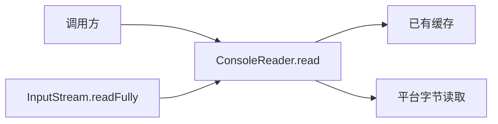

# 标准输入读取行为修复

* CJEEP ID：待分配
* Author(s)：HenonBamboo（@HenonBamboo_YYJ）
* Status：Reviewing
* Implementation：[runtime !1641](https://gitcode.com/Cangjie/cangjie_runtime/merge_requests/1641)、[docs !617](https://gitcode.com/Cangjie/cangjie_docs/merge_requests/617)、[test !1943](https://gitcode.com/Cangjie/cangjie_test/merge_requests/1943)。既有 PR 对应标准输入修复、文档和回归。

# 1、特性需求/问题/动机的来源与价值

来源：[runtime issue #596](https://gitcode.com/Cangjie/cangjie_runtime/issues/596) 及 [PR !1641](https://gitcode.com/Cangjie/cangjie_runtime/merge_requests/1641)。

`std.env.ConsoleReader.read(Array<Byte>)` 当前按行取数并尝试填满数组。在管道请求—应答场景中，写端发送少量数据后等待响应，读端等待换行或数组填满，可能造成双方互等。

本方案允许标准输入返回短读结果，并提供显式读满方法，分别满足流式读取和固定长度读取需求。

# 2、特性影响分析

- 涉及模块：`std.env`、`std.io`、`std.core` 原生输入层，以及配套文档和测试。
- 平台：Windows 重定向输入使用 `ReadFile`，字符设备保留宽字符读取；POSIX 使用 `read`。
- 行为兼容：`ConsoleReader.read` 签名不变，但可能在数组未满时返回。调用方应处理返回计数对应的前缀；依赖读满的代码改用 `readFully`。
- API/ABI：`InputStream` 新增默认成员，相关标准库和预编译依赖需配套重编，完成 ABI 检查后发布。
- 性能：原生层增加固定 512 字节共享缓存；读满循环使用数组切片，不增加等长中间缓冲区。

# 3、业界竞品分析

Java [DataInput.readFully](https://docs.oracle.com/en/java/javase/25/docs/api/java.base/java/io/DataInput.html#readFully(byte%5B%5D))、Rust [Read.read_exact](https://doc.rust-lang.org/std/io/trait.Read.html#method.read_exact) 均提供显式读满能力。本方案采用接口默认方法，调用形式为 `input.readFully(buffer)`。

# 4、本特性的设计/实现方案

## 4.1 标准输入读取



1. 空数组直接返回 0；已有缓存时复制可用数据并返回实际计数。
2. 重定向输入不再等待换行或填满数组。没有数据时仍可阻塞。
3. 原生行读取与数组读取共享缓存并加锁，避免绕过预取数据。POSIX 遇 EINTR 重试，Windows 断管按 EOF 处理。

补齐 `InputStream.read` 契约：单次不保证填满；短读不表示 EOF；非空目标在正常结束且未读到数据时返回 0。`ConsoleReader` 读取失败也可能返回 0 的历史行为保留并在文档中说明。

## 4.2 显式读满

在 `std.io.InputStream` 中新增默认方法：

```cangjie
func readFully(buffer: Array<Byte>): Unit
```

默认实现循环调用 `this.read`，每次读取剩余切片：

- 填满后返回；空数组不调用底层读取。
- 未满时返回 0，或返回计数超出请求范围，抛 `IOException`。
- 底层异常原样传播；失败后数组可能部分写入。

现有输入流可继承默认实现。方法不关闭流，多次读取不保证整体互斥。

同步中英文 API、用户指南及回归用例。实现分别位于 `console_reader.cj`、`native.cj`、`core/native/console_read.c` 和 `io/stream.cj`。

# 5、DFX分析

提前结束时报告目标长度和已读长度，底层异常原样传播，便于定位输入不足或读取失败。

# 6、可信分析

剩余切片限定每次请求长度，并校验返回计数；使用锁保护原生共享缓存。新增异常信息不包含输入内容。

# 7、关键DT用例简述

| 测试用例 | 预置条件 | 关键步骤 | 预期结果 |
| --- | --- | --- | --- |
| 管道短读 | 写端保持打开 | 分别发送有、无换行的少量数据 | 数组未满时返回有效前缀 |
| 延迟输入与 EOF | 初始无数据或输入已结束 | 等待后发送数据，或关闭写端 | 不误报 EOF；结束时返回 0 |
| 缓存混读 | 同一输入流 | 交替调用 readUntil、readln 和数组读取 | 数据不丢失、不重复 |
| 读满与提前结束 | 输入分段到达 | 调用 readFully，随后补齐或关闭输入 | 填满成功，提前结束抛异常 |
| 边界与继承 | 空数组、切片、自定义流 | 验证异常、非法计数及默认方法继承 | 行为符合接口契约 |

Windows x64 下契约、管道、文件及既有回归通过；其他平台和正式 ABI 门禁待验证。

# 8、结论

待评审确认标准输入短读行为变更、`readFully` 默认成员设计及配套发布方式。
