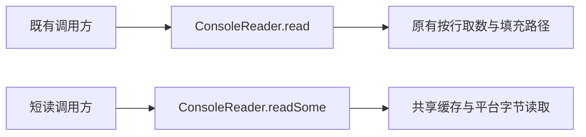

# 标准输入短读 API

* CJEEP ID：待分配
* Author(s)：HenonBamboo（@HenonBamboo_YYJ）
* Status：Reviewing
* Implementation：[runtime !1641](https://atomgit.com/Cangjie/cangjie_runtime/merge_requests/1641)、[docs !617](https://atomgit.com/Cangjie/cangjie_docs/merge_requests/617)、[test !1943](https://atomgit.com/Cangjie/cangjie_test/merge_requests/1943)。配套 PR 按本方案修订实现、文档和回归。

# 1、特性需求/问题/动机的来源与价值

来源：[runtime issue #596](https://atomgit.com/Cangjie/cangjie_runtime/issues/596) 及 [PR !1641](https://atomgit.com/Cangjie/cangjie_runtime/merge_requests/1641)。

`std.env.ConsoleReader.read(Array<Byte>)` 当前按行取数并尝试填满数组。在管道请求—应答场景中，写端发送少量数据后等待响应，读端等待换行或数组填满，可能造成双方互等。

本方案保留原有 `ConsoleReader.read` 行为，新增允许短读的 `readSome`，由调用方主动选择，满足标准输入的流式读取需求。旧 `read` 在输入结束或读取失败时仍可返回不足长度；使用新方法的调用方按返回计数处理有效前缀，并按协议自行累计数据。

# 2、特性影响分析

- 涉及模块：`std.env`、`std.core` 原生输入层，以及 `std.io.InputStream.read` 契约说明、配套文档和测试。
- 平台：Windows 重定向输入使用 `ReadFile`，旧行读取路径保留默认文本语义（CRLF 转为 LF，`0x1A` 作为 EOF），独立使用 `readSome` 则保留原始字节；字符设备保留宽字符读取。POSIX 使用 `read`。
- 行为兼容：保留 `ConsoleReader.read` 的签名和原有按行取数、尝试填满行为，不废弃旧接口。短读由新方法 `readSome` 提供，现有调用方不因新增能力而自动切换读取语义。
- API/ABI：仅新增 `ConsoleReader.readSome`；`InputStream` 保持原有成员结构。保持接口结构不等于整项变更已获得二进制兼容性证明；新增类成员、原生实现及预编译依赖仍需完成兼容性检查。
- 性能：原生层增加固定 512 字节共享缓存，已有缓存时直接复制可用数据，不继续等待填满调用方数组。

# 3、业界竞品分析

Java [InputStream.read](https://docs.oracle.com/en/java/javase/25/docs/api/java.base/java/io/InputStream.html#read(byte%5B%5D))、Rust [Read.read](https://doc.rust-lang.org/std/io/trait.Read.html#method.read) 均允许单次读取少于目标缓冲区容量的数据，由调用方依据实际计数处理结果。允许短读不代表非阻塞。本方案结合既有接口的兼容性约束，以新方法 `readSome` 提供短读能力，保留旧 `read` 的等待与填充行为。

# 4、本特性的设计/实现方案



`ConsoleReader.read` 保留原有循环：从按行读取路径获取数据，尝试填满数组；输入结束或读取失败时返回已取得的有效前缀。该方法可能等待换行，不用于保证管道请求—应答场景的及时返回。

新增方法：

```cangjie
public func readSome(arr: Array<Byte>): Int64
```

1. 空数组直接返回 0；已有缓存时复制可用数据并返回实际计数，不继续等待新数据填满数组。
2. 重定向输入使用平台字节读取，不要求换行，也不等待数组填满或写端关闭。没有数据时仍可阻塞；交互终端继续受终端输入模式影响。
3. 原生行读取与字节读取共享缓存并加锁，避免绕过预取数据；同一 `ConsoleReader` 内混用新旧方法保持消费顺序。Windows 下，若 `read`、`readln` 或 `readUntil` 已将数据预取到该实例缓存，`readSome` 会先取得已经过文本转换的剩余数据，不能保证混用仍保持输入原始字节。需要原始字节的协议应从开始就使用 `readSome`。POSIX 遇 EINTR 重试，Windows 断管按 EOF 处理。

共享原生缓存不等于共享所有上层缓存，不承诺任意交替 `ConsoleReader` 和 `std.core` 行读取的全局顺序；也不承诺与外部 CRT `getchar`、`_setmode` 或 `freopen` 混用的兼容性。

`InputStream.read` 的通用契约仍允许短读，具体实现可以尝试填满。短读不表示 EOF；调用方只处理返回计数对应的前缀。`ConsoleReader` 的读取失败也可能返回 0，`readSome` 保留这一限制并明确说明，不能将 0 解释为所有情况下都只有正常 EOF。

同步中英文 API、用户指南及回归用例。实现涉及 `console_reader.cj`、`env/native.cj` 和 `core/native/console_read.c`；`io/stream.cj` 保留原有接口成员结构。

# 5、DFX分析

返回实际读取字节数，调用方只处理有效前缀。部分底层读取失败仍映射为 0，本方案不改变这一既有错误处理方式，也不新增错误诊断保证。

# 6、可信分析

读取长度受目标数组容量限制，未写入部分保持不变；使用锁保护实例缓冲区及原生共享缓存。短读不识别消息边界，按字节分块可能截断 UTF-8 字符，调用方需按协议累计数据并处理字符边界。

# 7、关键DT用例简述

| 测试用例 | 预置条件 | 关键步骤 | 预期结果 |
| --- | --- | --- | --- |
| 旧读取兼容 | 分行输入、提前 EOF 或缓存剩余 | 直接或通过 InputStream 调用 read | 保持按行取数、尝试填满及不足长度返回行为 |
| 管道短读 | 写端保持打开 | 分别发送有、无换行的少量数据并调用 readSome | 数组未满时返回有效前缀 |
| 延迟输入与 EOF | 初始无数据或输入已结束 | 等待后发送数据，或关闭写端 | 不误报 EOF；结束时返回 0 |
| 缓存混读 | 同一个 ConsoleReader | 交替调用 read、readSome、readUntil 和 readln | 按消费顺序返回；Windows 行路径预取部分保留文本转换结果，不保证混用时原始字节不变 |
| 原生缓存衔接 | ConsoleReader 自身无剩余缓存 | 按 readSome → std.core.readln → readSome 的顺序读取 | 指定序列不绕过原生预取数据；不承诺任意跨层混读 |
| 短读边界 | 空数组、切片、二进制输入 | 调用 readSome 并检查返回计数和目标数组 | 空数组返回 0，切片外及未写入部分保持不变，独立字节读取保留原始数据 |
| 平台与 ABI | Windows、POSIX 及预编译依赖 | 验证终端、管道、文件、CRLF、缓存边界及兼容性探针 | 明确各平台与二进制兼容性覆盖范围 |

本轮在 Windows x64 1.1.3、Linux x64 1.2.0 的任务私有 SDK 中重新编译了最终 `std.io` 和 `std.env`，标准输入兼容回归均通过，覆盖旧 `read` 等待与 EOF、新 `readSome` 短读、二进制输入、切片、新旧混读、Windows 文本转换及缓存边界；Linux POSIX PTY 检查通过。两平台的负向编译确认已撤除的接口不可调用，旧 `read` 可执行文件在原 SDK 和本轮私有库下输出一致；Linux 旧接口实现库与新 `ConsoleReader` 分派探针通过。本轮文档仅移除不再提议的接口及示例，保留的可执行示例未改动。以上为专项验证，不代表源版本 1.3 的完整 SDK 构建、正式 ABI 检查或全部 CI 门禁通过；Windows 真实交互终端本轮未验证。

# 8、结论

待评审确认保留旧 `read`、仅新增 `ConsoleReader.readSome` 的设计，并依据配套验证结果确定发布方式。
