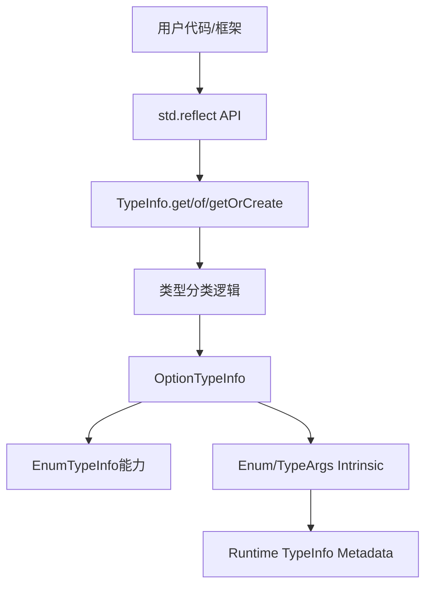
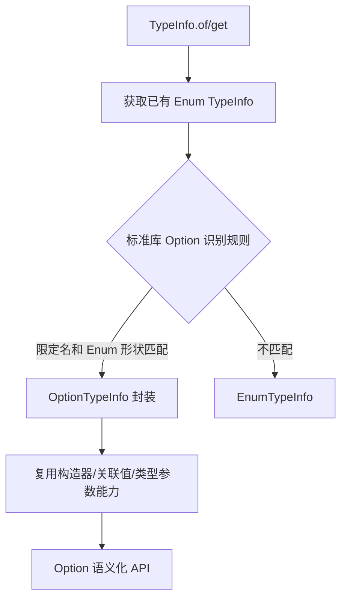

# 反射增加支持 Option 特性设计提案

* CJEEP ID：CJEEP-0011
* Author(s)：渣渣辉Zzzh
* Status：Reviewing
* Implementation：https://atomgit.com/Cangjie/cangjie_runtime/pull/1638

## 1、特性需求、问题、动机与价值

当前 `std.reflect` 已支持 class、struct、enum、interface、primitive、function 等类型的运行时元信息查询，但对 `Option<T>` 的专用支持不足。用户在编写通用框架、序列化/反序列化、依赖注入、测试工具、Mock 框架和动态调用工具时，无法通过反射统一处理 Option 类型。

本特性目标是补齐 `std.reflect` 对 `Option<T>` 的类型识别、类型参数查询、`Some`/`None` 构造、状态判断和值提取能力。

对于 `Option<T>`：

```cj
let oti = OptionTypeInfo.of<Option<Int64>>()
let valueType = oti.valueType           // Int64
let some = oti.constructSome(1)
let none = oti.constructNone()
let v = oti.getValue(some)              // Some(1)
```

期望效果：

- 用户可以通过统一的反射入口识别 Option。
- 反射框架可对 `Option<T>` 查询 `T` 类型、构造 `Some`/`None`、判断状态并提取值。
- 避免外部用户依赖 Option 的 enum 构造器布局细节，提升 API 语义稳定性。

## 2、特性影响分析

### 系统位置与周边接口



本特性位于标准库 `std.reflect` 包，**不要求仓颉运行时为 `Option` 增加专用标记、分支或新 ABI**。实现只使用运行时已经提供的通用 Enum TypeInfo 能力，在标准库侧识别并封装 Option。

涉及模块：

- 标准库反射模块：`stdlib/libs/std/reflect`
- 标准库已有的 Enum TypeInfo / intrinsic 封装
- 文档与测试：`stdlib/doc/libs/std/reflect`、反射相关 DT/单测

关键文件：

- `stdlib/libs/std/reflect/type_info_cjnative.cj`
- `stdlib/libs/std/reflect/option_type_info_cjnative.cj`
- `stdlib/libs/std/reflect/enum_type_info_cjnative.cj`（仅将 `EnumTypeInfo` 由 `public class` 调整为 `public open class`，以支持 `OptionTypeInfo` 继承）
- `stdlib/libs/std/reflect/intrinsic_cjnative.cj`（仅复用已有 Enum TypeInfo 能力，不新增 runtime intrinsic）

不修改 `runtime/src/TypeInfoManager.*`、`runtime/src/CommonAlias.h`，也不新增 Option 专用运行时元数据或 C ABI 符号。

### 实现边界

- 运行时只需按现有机制提供 Enum 的限定名、类型参数、构造器、构造器关联值等通用信息。
- Option 的识别、类型封装和语义化 API 全部在 `std.reflect` 中完成。
- 若运行时返回的 Enum 元信息不满足 Option 识别规则，标准库应将其视为普通 `EnumTypeInfo`，不得依赖未定义的运行时行为。

### 环境依赖

- 多 target：依赖标准库现有 cjnative 反射能力。
- 多 OS：Linux/macOS/Windows 复用同一套 Enum TypeInfo 能力。
- 是否可用只取决于目标环境是否已有通用 Enum 反射能力，不取决于是否实现 Option 专用 runtime 支持。

### 依赖关系与关键约束

OptionTypeInfo 依赖：

- `EnumTypeInfo`
- 现有的类型参数查询能力
- `EnumTypeInfo.getConstructor`
- `EnumTypeInfo.destruct` 或等价的关联值读取能力

关键约束：

- 继承前提：`OptionTypeInfo <: EnumTypeInfo` 要求基类可被继承，而仓颉中非抽象类必须显式使用 `open` 修饰才能被继承，因此需要将现有 `EnumTypeInfo` 由 `public class EnumTypeInfo <: TypeInfo` 调整为 `public open class EnumTypeInfo <: TypeInfo`。该调整只增加继承性修饰符，不改变成员签名、实现和实例化方式。
- `Option<T>` 在运行时按普通 Enum 提供元信息；运行时不需要知道 `Option` 是特殊类型。
- 标准库通过稳定的限定名、构造器名称/形状和类型参数信息识别 Option，识别规则必须集中在 `std.reflect` 内。
- 动态构造时必须校验目标 Enum、构造器和参数类型，避免构造非法对象。
- `OptionTypeInfo` 只封装已有 Enum 能力，不改变 Option 的底层布局。
- 若识别所需信息缺失或形状不符合约定，应抛出明确的反射异常，不能猜测或调用不存在的 runtime 能力。

### 前后版本兼容性

API 兼容性：

- 新增 `OptionTypeInfo`，属于增量 API。
- `EnumTypeInfo` 由 `public class` 调整为 `public open class`，属于源兼容的继承性调整：既有调用、`TypeInfo` 子类判断和直接实例化行为保持不变；同时该基类成为对外可继承类型，其公开成员构成继承契约。
- `TypeInfo.of/get/getOrCreate` 对符合识别规则的 Option 返回更具体的子类型，符合既有 `TypeInfo` 抽象，不破坏已有调用。
- 其他 Enum 仍返回 `EnumTypeInfo`；不需要修改 runtime 对 Enum 的既有行为。

ABI 兼容性：

- 仅新增标准库公开类型和方法，按标准库 ABI 版本策略评估。
- `EnumTypeInfo` 的继承性由「不可继承」变为 `open`，属于类型元信息层面的对外可感知变更，需与标准库 ABI/版本策略一并评估；不新增导出符号，不改动既有符号签名。
- 不新增 runtime C ABI 导出符号，不引入 Option 专用 ABI 兼容性问题。

外部用户感知：

- 用户可感知，属于 `std.reflect` 能力增强。
- 对已有 Enum 反射调用保持兼容；只有符合标准库识别规则的 Option 类型会返回 `OptionTypeInfo`。

### 性能影响

- Option 识别只读取已有 Enum 元信息，复杂度为 O(构造器数量 + 类型参数数量)。
- `OptionTypeInfo.valueType` 首次查询解析并缓存类型参数，后续为 O(1)。
- `constructSome/getValue` 复用 Enum 构造和关联值读取能力，复杂度与关联值数量相关。
- 不增加 runtime 元数据字段；标准库仅增加少量 `TypeInfo` 缓存对象。


## 3、业界竞品分析

### Java/Kotlin

Java/Kotlin 反射对普通 class 和泛型类支持较成熟。Kotlin 的 nullable 类型在运行时通常退化，空安全更多依赖编译期类型系统，运行时反射获取完整语义需要依赖 Kotlin metadata。

启示：

- `Option<T>` 不应只当普通 enum 暴露，应保留 Option 语义 API。
- 运行时如果有完整类型参数信息，应通过专用接口直接提供。

### Swift

Swift 的 Mirror 可以看到 Optional 的 `some`/`none` 结构，用户可基于 Mirror 做通用序列化和调试展示。

启示：

- Option 反射最关键的是区分有值/无值并提取关联值。

### Rust

Rust 标准库没有通用运行时反射。`Option<T>` 主要通过编译期类型系统、模式匹配和 derive 宏处理。

启示：

- 仓颉若提供运行时反射，应让动态框架直接使用标准库能力，避免每个框架重复编码 Option 特判。

## 4、本特性的设计/实现方案

### 整体流程



流程说明：

1. `TypeInfo.of/get/getOrCreate` 通过现有反射入口取得 Enum 的通用 TypeInfo。
2. `std.reflect` 读取 Enum 的限定名、类型参数、构造器和关联值元信息。
3. 标准库根据集中定义的 Option 识别规则判断目标是否为 `Option<T>`；该判断不调用任何 Option 专用 runtime API。
4. 匹配成功后创建 `OptionTypeInfo`，其操作全部委托给 `EnumTypeInfo` 已提供的能力；不匹配则保持普通 `EnumTypeInfo`。

Option 识别规则：

- 类型限定名必须是仓颉标准库约定的 `Option` 类型名及其泛型实例形式。
- Enum 必须包含表示有值和无值状态的两个约定构造器：`Some` 携带一个关联值，`None` 不携带关联值。
- `Option<T>` 必须能从现有类型参数元信息取得唯一的 `T`。
- 任一条件不满足时不识别为 `OptionTypeInfo`，避免把普通 Enum 错误封装为 Option。

上述名称和形状是标准库反射层的识别约定，不是运行时新增的 Option 标记。若未来 Option 的限定名或构造器形状变化，只需同步标准库识别规则和测试。

### OptionTypeInfo 设计

新增类型：

```cj
// 基类需由 `public class` 调整为 `public open class`，否则 `OptionTypeInfo` 无法继承
public open class EnumTypeInfo <: TypeInfo
public class OptionTypeInfo <: EnumTypeInfo
```

设计原因：

- `Option<T>` 在运行时没有专用标记，只以普通 Enum 的 TypeInfo 形式出现。
- `OptionTypeInfo` 继承 `EnumTypeInfo`，直接复用 Enum 的类型参数、构造器和关联值能力。
- 继承前提：仓颉中非抽象类必须用 `open` 修饰才能被继承，因此需要把 `enum_type_info_cjnative.cj` 中的 `public class EnumTypeInfo <: TypeInfo` 调整为 `public open class EnumTypeInfo <: TypeInfo`。`OptionTypeInfo` 是 `EnumTypeInfo` 的直接子类，不满足该前提时本方案无法编译通过。
- Option 的识别与语义化操作由标准库完成，降低用户对 `Some`/`None` 底层布局的依赖，同时不要求 runtime 感知 Option。

`EnumTypeInfo` 可继承性的方案选择：

- 调整为 `open class`（推荐）：满足 `OptionTypeInfo <: EnumTypeInfo` 的编译要求，且 `EnumTypeInfo` 仍可直接实例化，`TypeInfo` 的 Enum 分支继续构造普通 `EnumTypeInfo`。
- 调整为 `abstract class`：抽象类默认可被继承，但会禁止直接实例化，与「普通 Enum 返回 `EnumTypeInfo` 实例」的既有行为冲突，排除。
- 调整为 `sealed`：`sealed` 可限定本包内继承，但仓颉规定 `sealed` 不能用于非抽象类，排除。
- 不继承、改为组合包装 `EnumTypeInfo`：需转发全部 Enum API，且 `TypeInfo` 的 `case oti: OptionTypeInfo` 分类判断与「OptionTypeInfo 仍可按 EnumTypeInfo 使用」的兼容要求都会退化，排除。

`open` 的附带影响：

- `EnumTypeInfo` 是 `sealed abstract class TypeInfo` 的子类，按仓颉规则，被 `open` 修饰的子类可在包外被继承，即本特性对外开放了一个派生点。
- 包外派生的可行性受限：`EnumTypeInfo` 的 `init(cp: CPointer<Unit>)` 使用默认访问级别（本包及子包可见），包外派生需要能调用父类构造器，因此包外派生在实践中不可行；该约定建议在评审中显式确认。
- 一旦声明为 `open`，`EnumTypeInfo` 的公开成员即构成对外继承契约，后续成员改名、改签名或语义调整不再属于纯内部变更，需按兼容性策略评估。

公开 API：

```cj
public prop valueType: TypeInfo
public static redef func of(instance: Any): OptionTypeInfo
public static redef func of<T>(): OptionTypeInfo
public static redef func get(qualifiedName: String): OptionTypeInfo
public func constructSome(value: Any): Any
public func constructNone(): Any
public func isSome(instance: Any): Bool
public func isNone(instance: Any): Bool
public func getValue(instance: Any): Option<Any>
```

功能：

- `valueType` 从 Enum TypeInfo 的类型参数中取得 `Option<T>` 的 `T`，首次查询后缓存；若类型参数缺失或不唯一，抛出 `InfoNotFoundException`。
- `of` 从实例或泛型类型获取 Enum TypeInfo 后执行标准库 Option 识别；`get` 从限定名获取类型信息并执行同一识别流程；如果目标不是符合规则的 Option，抛出 `IllegalTypeException`。
- `constructSome` 查找名为 `Some` 且具有一个关联值的 Enum 构造器，校验 value 类型后调用已有 Enum 构造能力；`constructNone` 查找名为 `None` 且无关联值的构造器。
- `isSome` 和 `isNone` 基于实例的 Enum 构造器信息判断状态，不增加 runtime 分支。
- `getValue(Some(v))` 通过已有 Enum 关联值读取能力返回 `Option<Any>.Some(v)`，`getValue(None)` 返回 `Option<Any>.None`；若构造器或关联值形状异常，抛出 `ReflectException`。

### 涉及源文件变更

`stdlib/libs/std/reflect/enum_type_info_cjnative.cj`

- 将 `public class EnumTypeInfo <: TypeInfo` 调整为 `public open class EnumTypeInfo <: TypeInfo`，使 `OptionTypeInfo` 具备可继承的基类。
- 仅新增 `open` 修饰符，不改动 `EnumTypeInfo` 的成员签名、实现、成员访问级别和实例化方式；`TypeInfo` 的 Enum 分类分支仍直接构造普通 `EnumTypeInfo`。
- 需要同步评估 `open` 带来的对外派生点：包外派生需要可访问的父类构造器，而 `EnumTypeInfo.init(cp: CPointer<Unit>)` 使用包内可见的默认访问级别，包外派生实践上不可行，该限制建议在文档中作为约定声明。

`stdlib/libs/std/reflect/type_info_cjnative.cj`

- 在现有 Enum 分类之后调用标准库侧的 `isOptionType` 判断；匹配限定名、类型参数和 `Some`/`None` 构造器形状后创建 `OptionTypeInfo`，否则创建普通 `EnumTypeInfo`。
- 新增/整理 `isOptionType` 辅助逻辑，集中处理限定名规范化、构造器查找和形状校验。

`stdlib/libs/std/reflect/option_type_info_cjnative.cj`

- 新增 `OptionTypeInfo` 类型。
- 通过 `EnumTypeInfo` 已有 API 查询类型参数、定位构造器、构造实例和读取关联值。
- 不直接调用 runtime API，也不维护与 runtime 同步的 Option 特殊状态。

`stdlib/libs/std/reflect/intrinsic_cjnative.cj`

- 仅复用已有的 Enum TypeInfo intrinsic，例如类型参数、构造器和关联值查询/构造能力。
- 不新增 `Option` 专用 intrinsic。

runtime：

- `runtime/src/TypeInfoManager.*` 和 `runtime/src/CommonAlias.h` 无需修改。
- 直接复用现有 Enum TypeInfo 和 ABI；不新增 Option 专用元数据字段、分类分支或 C ABI 符号。

### 方案选择

方案一：将 Option 作为普通 `TypeInfo` 暴露。

优点：

- 实现简单。
- API 表面较小。

缺点：

- 用户仍需自行判断和解析底层结构。
- Option<T> 语义不明确。

方案二：Option<T> 仍作为 `EnumTypeInfo`，不增加专用类型。

优点：

- 实现成本低。
- 完全复用既有 Enum 能力。

缺点：

- 用户仍需依赖 `Some`/`None` 构造器名和布局。
- Option 语义分散在各个调用方，不利于统一的序列化、Mock 和动态调用。

方案三：新增 `OptionTypeInfo`，其中 `OptionTypeInfo <: EnumTypeInfo`，由标准库基于已有 Enum TypeInfo 识别并封装。

优点：

- 提供语义化 API。
- 保留 Enum 兼容能力。
- 对外 API 清晰，便于序列化、Mock、动态调用框架使用。
- 不要求 runtime 增加 Option 专用实现，底层 Enum 表示变化时可在标准库封装层适配。

缺点：

- 新增公开 API，需要维护文档和测试。
- TypeInfo 类型分类逻辑增加少量复杂度。
- 识别规则依赖 Option 的稳定限定名和构造器约定，规则变化时需要同步标准库。

结论：推荐方案三。

## 5、DFX 分析

### 可维护性

- `OptionTypeInfo` 独立于 `option_type_info_cjnative.cj`，避免把特化逻辑堆在 TypeInfo 主文件。
- `TypeInfo` 仅负责取得 Enum TypeInfo、执行标准库侧识别并创建具体 TypeInfo 子类。
- `OptionTypeInfo` 继承 `EnumTypeInfo`，复用现有 Enum 类型参数、构造器和关联值能力。
- `EnumTypeInfo` 声明为 `open` 后，其公开成员构成对外继承契约，成员签名变更需按兼容性策略评估；`OptionTypeInfo` 只依赖其公开 API，不增加基类内部耦合。

### 可测试性

- API 行为可通过 `TypeInfo.of<T>()`、`TypeInfo.of(instance)`、`TypeInfo.get(name)` 三类入口覆盖。
- 异常路径明确：类型不匹配、元信息缺失、关联值异常。
- 可通过标准库 DT 覆盖基础类型、嵌套类型、泛型类型。

### 可诊断性

- 异常信息包含目标类型、期望类型、实际类型等信息。
- 对 Option 构造失败、value type 缺失等场景抛出明确异常。

### 性能

- 元信息查询复用 `TypeInfo.CACHE`。
- `OptionTypeInfo.valueType` 内部缓存，避免重复解析 type args。

### 兼容性

- 新增 API 为增量能力。
- `EnumTypeInfo` 由 `public class` 调整为 `public open class`：既有代码、类型判断和实例化行为不变，仅新增可继承性；包外派生受父类构造器包内可见限制，实践上仍不可行。
- `OptionTypeInfo <: EnumTypeInfo` 保持旧 Enum 使用方式可继续工作。
- runtime 无需新增 Option 标识或 ABI；不识别的 Enum 继续按既有 `EnumTypeInfo` 处理。

## 6、可信分析

安全性 Security：

- 动态构造 Option 前做类型检查，防止构造与元信息不一致的对象。
- 不暴露裸指针给外部用户，intrinsic 指针操作封装在 `std.reflect` 内部。
- 异常信息不包含敏感内存地址。

可靠性 Reliability：

- 对空指针、元信息缺失、类型不匹配均显式抛异常。
- `OptionTypeInfo.valueType` 缓存内容来自不可变 runtime TypeInfo，稳定可靠。

韧性 Resilience：

- `OptionTypeInfo` 封装 Some/None 操作，未来如果 Option 底层实现调整，可在该类型内部适配。

可用性 Availability：

- 在已有通用 Enum 反射能力的 target 上开放。
- 若通用 Enum 元信息缺失，或目标 Enum 不满足 Option 识别规则，明确抛出反射异常或返回普通 `EnumTypeInfo`，而不是产生未定义行为。

隐私 Privacy：

- 本特性只暴露类型元信息和值本身，不新增外部数据采集、持久化或网络行为。
- 调用者能反射访问的数据仍受现有反射访问控制规则约束。

无害 Safety：

- 不涉及物理世界控制、医疗、车辆等安全关键场景。
- 主要风险来自错误构造动态对象，已通过类型检查缓解。

## 7、关键 DT 用例简述

| 测试用例名称 | 预置条件 | 用例关键步骤 | 预期结果 |
|---|---|---|---|
| `reflect_option_type_of_generic` | 已启用通用 Enum 反射 | 调用 `OptionTypeInfo.of<Option<Int64>>()` | 返回 OptionTypeInfo，`valueType` 为 Int64 |
| `reflect_option_get_by_name` | 已加载 `std.core.Option<Int64>` 的 Enum TypeInfo | 调用 `OptionTypeInfo.get("Option<Int64>")` | 返回 OptionTypeInfo |
| `reflect_option_recognized_from_enum_shape` | 仅提供普通 Enum TypeInfo | 检查 Option 识别过程 | 不调用 Option 专用 runtime 能力，按限定名、类型参数和构造器形状完成判断 |
| `reflect_option_construct_some_success` | 获取 Option<Int64> 类型信息 | 调用 `constructSome(1)` | 复用 Enum 构造能力，返回 Some(1) |
| `reflect_option_construct_some_type_mismatch` | 获取 Option<Int64> 类型信息 | 调用 `constructSome("a")` | 抛出 IllegalTypeException |
| `reflect_option_construct_none_success` | 获取 Option<Int64> 类型信息 | 调用 `constructNone()` | 复用 Enum 构造能力，返回 None |
| `reflect_option_is_some_none` | 构造 Some(1) 和 None | 分别调用 `isSome`/`isNone` | 判断结果正确 |
| `reflect_option_get_value` | 构造 Some(1) 和 None | 调用 `getValue` | Some(1) 返回 `Option<Any>.Some(1)`，None 返回 `Option<Any>.None` |
| `reflect_non_option_enum` | 获取具有其他限定名或构造器形状的 Enum | 调用 `TypeInfo.of` | 返回普通 EnumTypeInfo，不误判为 OptionTypeInfo |
| `reflect_option_classification` | 调用 `TypeInfo.of<Option<Int64>>()` | 使用类型匹配判断实际子类 | 返回 OptionTypeInfo |
| `reflect_enum_type_info_open` | 已启用通用 Enum 反射 | 分别获取普通 Enum 与 `Option<Int64>` 的 TypeInfo，断言与 `EnumTypeInfo` 的关系 | `OptionTypeInfo` 可赋值给 `EnumTypeInfo`；普通 Enum 仍返回 `EnumTypeInfo` 且可正常实例化 |

## 8、结论

本特性建议通过新增 `OptionTypeInfo <: EnumTypeInfo` 完善 `std.reflect` 对 Option 的支持。

推荐方案为：

- `Option<T>` 建模为 `OptionTypeInfo <: EnumTypeInfo`。
- `TypeInfo` 先取得运行时提供的普通 Enum TypeInfo，再由标准库依据限定名、类型参数以及 `Some`/`None` 构造器形状识别 Option。
- `OptionTypeInfo` 仅复用已有 Enum 类型参数、构造器和关联值能力；不依赖 runtime 对 Option 的特别标注、分类分支、元数据字段或专用 intrinsic。
- 不符合识别规则的类型继续作为普通 `EnumTypeInfo` 处理。

评审结论建议：通过。

遗留问题：

| 问题 | 责任人 | 预计闭环时间 |
|---|---|---|
| Option 限定名和 `Some`/`None` 构造器形状是否作为稳定标准库约定 | 标准库反射责任人 | MR 合入前确认 |
| `EnumTypeInfo` 由 `public class` 调整为 `public open class`（对外开放继承点、公开成员成为继承契约）是否可接受，以及是否显式声明「仅包内可派生」 | 标准库反射责任人 | MR 合入前确认 |
| 现有 Enum TypeInfo 是否完整提供类型参数、构造器和关联值读取/构造能力 | 标准库与 runtime 责任人 | DT 开发前确认 |
| 新增 API 文档与中英文文档是否同步 | 标准库文档责任人 | MR 合入前完成 |

## 附录一、可测试性设计

主要覆盖场景：

- 类型入口：`TypeInfo.of<T>()`、`TypeInfo.of(instance)`、`TypeInfo.get(name)`。
- Option 元信息：`Option<Int64>`、`Option<String>`、嵌套 `Option<Option<T>>`。
- Option 动态行为：Some 构造、None 构造、`isSome`/`isNone`、`getValue`。
- 兼容行为：`OptionTypeInfo` 仍可作为 `EnumTypeInfo` 使用。
- 兼容行为：`EnumTypeInfo` 由 `public class` 调整为 `public open class` 后，普通 Enum 仍返回 `EnumTypeInfo` 且可正常实例化，既有 `EnumTypeInfo` API 行为不变。
- 异常行为：错误类型调用 `OptionTypeInfo.of` 时异常类型和错误信息正确。

## 附录二、评审范围判断

本特性属于标准库 `std.reflect` API 设计及实现，使用 runtime 已提供的通用 Enum TypeInfo 能力，但不要求 runtime 针对 Option 增加实现，满足架构/功能实现评审范围：

- 标准库 API 设计及实现。
- 影响反射框架对语言核心类型的处理方式。
- 复用标准库与 runtime 已有的 Enum TypeInfo 交互。
- 对外部开发者可感知。
