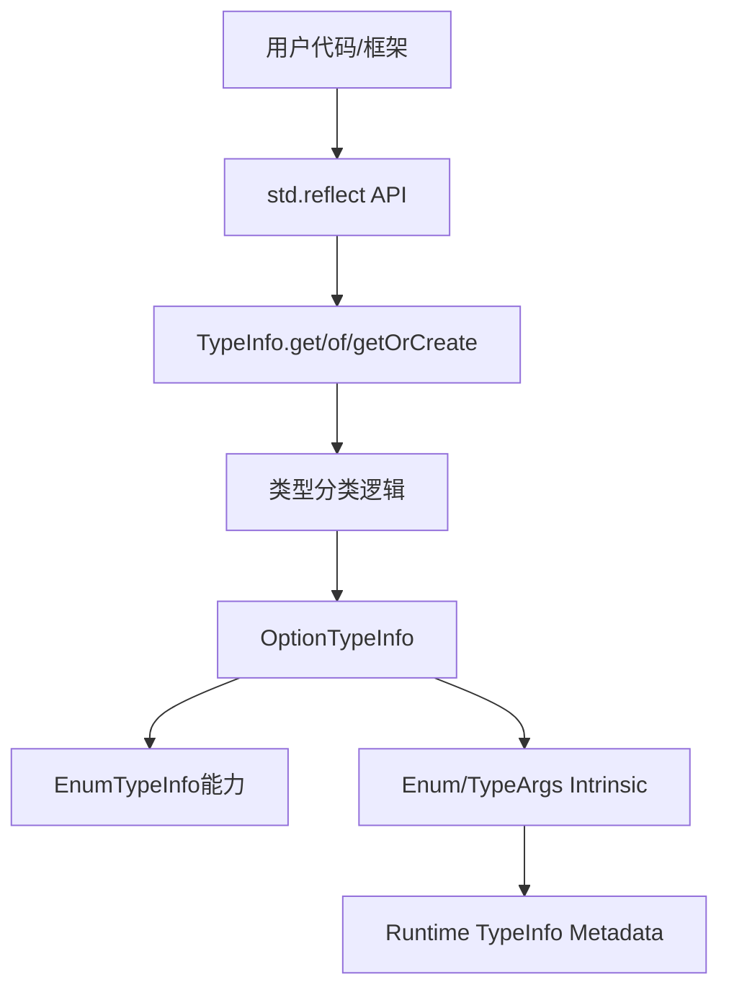
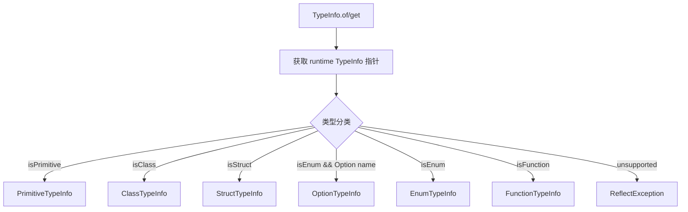

# 反射增加支持 Option 特性设计提案

## 1、特性需求、问题、动机与价值

当前 `std.reflect` 已支持 class、struct、enum、interface、primitive、function 等类型的运行时元信息查询，但对 `Option<T>` 的专用支持不足。用户在编写通用框架、序列化/反序列化、依赖注入、测试工具、Mock 框架和动态调用工具时，无法通过反射统一处理 Option 类型。

本特性目标是补齐 `std.reflect` 对 `Option<T>` 的类型识别、类型参数查询、`Some`/`None` 构造、状态判断和值提取能力。

对于 `Option<T>`：

```cj
let oti = OptionTypeInfo.of<Option<Int64>>()
let valueType = oti.valueType           // Int64
let some = oti.constructSome(1)
let none = oti.constructNone()
let v = oti.getValue(some)              // Some(1)
```

期望效果：

- 用户可以通过统一的反射入口识别 Option。
- 反射框架可对 `Option<T>` 查询 `T` 类型、构造 `Some`/`None`、判断状态并提取值。
- 避免外部用户依赖 Option 的 enum 构造器布局细节，提升 API 语义稳定性。

## 2、特性影响分析

### 系统位置与周边接口



本特性位于标准库 `std.reflect` 包，依赖运行时 TypeInfo 元数据和反射 intrinsic。

涉及模块：

- 标准库反射模块：`stdlib/libs/std/reflect`
- 运行时反射符号导出：`runtime/src/CommonAlias.h`
- 运行时 TypeInfo 能力：`runtime/src/TypeInfoManager.*` 及已有 metadata 能力
- 文档与测试：`stdlib/doc/libs/std/reflect`、反射相关 DT/单测

关键文件：

- `stdlib/libs/std/reflect/type_info_cjnative.cj`
- `stdlib/libs/std/reflect/option_type_info_cjnative.cj`
- `stdlib/libs/std/reflect/intrinsic_cjnative.cj`
- `runtime/src/CommonAlias.h`

### 环境依赖

- 多 target：涉及标准库 cjnative 反射能力。
- 多后端：当前实现通过 `@When[env != "ohos"]` 开启，OHOS 环境暂不启用该能力。
- 多 OS：Linux/macOS/Windows 理论上依赖同一 runtime metadata 能力；需通过现有 CI target 验证。
- 后端必须提供 `getTypeArgs`、enum 构造和关联值读取所需 intrinsic；否则不可直接开放 API。

### 依赖关系与关键约束

OptionTypeInfo 依赖：

- `EnumTypeInfo`
- `getTypeArgs`
- `EnumTypeInfo.getConstructor`
- `EnumTypeInfo.destruct`

关键约束：

- `Option<T>` 在 runtime 表示上属于 enum metadata，因此 `OptionTypeInfo` 设计为继承 `EnumTypeInfo`，保留 enum 反射能力。
- 动态构造时必须校验参数类型，避免 runtime 构造非法对象。
- `Option<T>` 的公开 API 不应暴露 `Some`/`None` 底层构造器布局作为唯一使用方式。

### 前后版本兼容性

API 兼容性：

- 新增 `OptionTypeInfo`，属于增量 API。
- `TypeInfo.of/get/getOrCreate` 对 Option 返回更具体的子类型，符合既有 `TypeInfo` 抽象，不破坏已有调用。
- 此前 Option 可能被识别为 `EnumTypeInfo`，新增后会识别为 `OptionTypeInfo <: EnumTypeInfo`；对依赖 `EnumTypeInfo` 的旧代码仍兼容。

ABI 兼容性：

- 标准库新增公开类型和方法，需确认 ABI 版本策略。
- 运行时导出符号若已存在，仅是标准库接入，无 ABI 破坏。
- 若新增 runtime C ABI 导出符号，需要按 runtime ABI 规范评估符号稳定性。

外部用户感知：

- 用户可感知，属于 `std.reflect` 能力增强。
- 可能影响用户对 `TypeInfo.of<Option<T>>()` 返回类型的运行时类型判断结果，但因 `OptionTypeInfo` 继承 `EnumTypeInfo`，影响可控。

### 性能影响

- `OptionTypeInfo.valueType` 首次查询为 O(1)，后续缓存后为 O(1)。
- `OptionTypeInfo.constructSome/getValue` 为 O(1)，底层 enum 构造/析构成本为常数或与关联值数量相关。
- `OptionTypeInfo` 缓存 `_valueType`，单实例空间复杂度为 O(1)。
- `TypeInfo` 复用既有 CACHE，新增类型只增加少量条目。

## 3、业界竞品分析

### Java/Kotlin

Java/Kotlin 反射对普通 class 和泛型类支持较成熟。Kotlin 的 nullable 类型在运行时通常退化，空安全更多依赖编译期类型系统，运行时反射获取完整语义需要依赖 Kotlin metadata。

启示：

- `Option<T>` 不应只当普通 enum 暴露，应保留 Option 语义 API。
- 运行时如果有完整类型参数信息，应通过专用接口直接提供。

### Swift

Swift 的 Mirror 可以看到 Optional 的 `some`/`none` 结构，用户可基于 Mirror 做通用序列化和调试展示。

启示：

- Option 反射最关键的是区分有值/无值并提取关联值。

### Rust

Rust 标准库没有通用运行时反射。`Option<T>` 主要通过编译期类型系统、模式匹配和 derive 宏处理。

启示：

- 仓颉若提供运行时反射，应让动态框架直接使用标准库能力，避免每个框架重复编码 Option 特判。

## 4、本特性的设计/实现方案

### 整体流程



### OptionTypeInfo 设计

新增类型：

```cj
public class OptionTypeInfo <: EnumTypeInfo
```

设计原因：

- `Option<T>` 运行时以 enum metadata 表达。
- 继承 `EnumTypeInfo` 可以保持原有 enum 构造器查询、析构能力。
- 同时增加 Option 专用语义 API，降低用户对 `Some`/`None` 构造器布局的依赖。

公开 API：

```cj
public prop valueType: TypeInfo
public static redef func of(instance: Any): OptionTypeInfo
public static redef func of<T>(): OptionTypeInfo
public static redef func get(qualifiedName: String): OptionTypeInfo
public func constructSome(value: Any): Any
public func constructNone(): Any
public func isSome(instance: Any): Bool
public func isNone(instance: Any): Bool
public func getValue(instance: Any): Option<Any>
```

功能：

- `valueType` 返回 `Option<T>` 中 `T` 的类型信息，首次查询后缓存；若 runtime type args 缺失，抛出 `InfoNotFoundException`。
- `of` 从实例或泛型类型获取 OptionTypeInfo，`get` 从限定名获取 OptionTypeInfo；如果目标不是 Option 类型，抛出 `IllegalTypeException`。
- `constructSome` 和 `constructNone` 构造 Some(value) 或 None；`constructSome` 校验 value 类型是否为 `valueType` 的子类型，类型不匹配时抛出 `IllegalTypeException`。
- `isSome` 和 `isNone` 判断 Option 实例状态。
- `getValue(Some(v))` 返回 `Option<Any>.Some(v)`，`getValue(None)` 返回 `Option<Any>.None`；若底层构造器值数量异常，抛出 `ReflectException`。

### 涉及源文件变更

`stdlib/libs/std/reflect/type_info_cjnative.cj`

- 在 `TypeInfo.getTypeInfoByPointer` 中新增 Option 类型分类：`isEnum && isOptionQualifiedName` 时创建 `OptionTypeInfo`。
- 新增 `isOptionQualifiedName` 辅助函数，用于识别：
  - `Option`
  - `Option<T>`
  - `std.core.Option`
  - `std.core.Option<T>`

`stdlib/libs/std/reflect/option_type_info_cjnative.cj`

- 新增 `OptionTypeInfo` 类型。
- 提供 Option value type 查询、Some/None 构造、状态判断和值提取能力。

`stdlib/libs/std/reflect/intrinsic_cjnative.cj`

- 声明/使用 Option 所需 intrinsic：
  - `getTypeArgs`
  - enum 构造相关 intrinsic
  - `getAssociatedValues`

`runtime/src/CommonAlias.h`

- 确认反射相关 C ABI 符号导出：
  - `CJ_MCC_GetTypeArgs`
  - 与 enum 构造、关联值读取相关的既有符号

### 方案选择

方案一：将 Option 作为普通 `TypeInfo` 暴露。

优点：

- 实现简单。
- API 表面较小。

缺点：

- 用户仍需自行判断和解析底层结构。
- Option<T> 语义不明确。

方案二：Option<T> 仍作为 `EnumTypeInfo`，不增加专用类型。

优点：

- 实现成本低。
- 可复用既有 enum 能力。

缺点：

- 用户仍需依赖 Some/None 构造器名和布局。
- 不利于未来调整 Option 底层表示。
- 与用户对 Option 空安全语义的认知不一致。

方案三：新增 `OptionTypeInfo`，其中 `OptionTypeInfo <: EnumTypeInfo`。

优点：

- 提供语义化 API。
- 保留 enum 兼容能力。
- 对外 API 清晰，便于序列化、Mock、动态调用框架使用。
- 后续可在 OptionTypeInfo 内部兼容底层表示变化。

缺点：

- 新增公开 API，需要维护文档和测试。
- TypeInfo 类型分类逻辑增加少量复杂度。

结论：推荐方案三。

## 5、DFX 分析

### 可维护性

- `OptionTypeInfo` 独立于 `option_type_info_cjnative.cj`，避免把特化逻辑堆在 TypeInfo 主文件。
- `TypeInfo` 仅负责分类和创建具体 TypeInfo 子类。
- `OptionTypeInfo` 继承 `EnumTypeInfo`，复用 enum 构造器、析构能力。

### 可测试性

- API 行为可通过 `TypeInfo.of<T>()`、`TypeInfo.of(instance)`、`TypeInfo.get(name)` 三类入口覆盖。
- 异常路径明确：类型不匹配、元信息缺失、关联值异常。
- 可通过标准库 DT 覆盖基础类型、嵌套类型、泛型类型。

### 可诊断性

- 异常信息包含目标类型、期望类型、实际类型等信息。
- 对 Option 构造失败、value type 缺失等场景抛出明确异常。

### 性能

- 元信息查询复用 `TypeInfo.CACHE`。
- `OptionTypeInfo.valueType` 内部缓存，避免重复解析 type args。

### 兼容性

- 新增 API 为增量能力。
- `OptionTypeInfo <: EnumTypeInfo` 保持旧 enum 使用方式可继续工作。
- OHOS 暂不启用，避免未具备 runtime 支撑的 target 出现行为不一致。

## 6、可信分析

安全性 Security：

- 动态构造 Option 前做类型检查，防止构造与元信息不一致的对象。
- 不暴露裸指针给外部用户，intrinsic 指针操作封装在 `std.reflect` 内部。
- 异常信息不包含敏感内存地址。

可靠性 Reliability：

- 对空指针、元信息缺失、类型不匹配均显式抛异常。
- `OptionTypeInfo.valueType` 缓存内容来自不可变 runtime TypeInfo，稳定可靠。

韧性 Resilience：

- `OptionTypeInfo` 封装 Some/None 操作，未来如果 Option 底层实现调整，可在该类型内部适配。

可用性 Availability：

- 对非 OHOS cjnative 环境开放。
- 若 runtime 不支持对应 metadata，明确抛出异常，而不是产生未定义行为。

隐私 Privacy：

- 本特性只暴露类型元信息和值本身，不新增外部数据采集、持久化或网络行为。
- 调用者能反射访问的数据仍受现有反射访问控制规则约束。

无害 Safety：

- 不涉及物理世界控制、医疗、车辆等安全关键场景。
- 主要风险来自错误构造动态对象，已通过类型检查缓解。

## 7、关键 DT 用例简述

| 测试用例名称 | 预置条件 | 用例关键步骤 | 预期结果 |
|---|---|---|---|
| `reflect_option_type_of_generic` | 已启用非 OHOS cjnative 反射 | 调用 `OptionTypeInfo.of<Option<Int64>>()` | 返回 OptionTypeInfo，`valueType` 为 Int64 |
| `reflect_option_get_by_name` | 已加载 `std.core.Option<Int64>` 类型 | 调用 `OptionTypeInfo.get("Option<Int64>")` | 返回 OptionTypeInfo |
| `reflect_option_construct_some_success` | 获取 Option<Int64> 类型信息 | 调用 `constructSome(1)` | 返回 Some(1) |
| `reflect_option_construct_some_type_mismatch` | 获取 Option<Int64> 类型信息 | 调用 `constructSome("a")` | 抛出 IllegalTypeException |
| `reflect_option_construct_none_success` | 获取 Option<Int64> 类型信息 | 调用 `constructNone()` | 返回 None |
| `reflect_option_is_some_none` | 构造 Some(1) 和 None | 分别调用 `isSome`/`isNone` | 判断结果正确 |
| `reflect_option_get_value` | 构造 Some(1) 和 None | 调用 `getValue` | Some(1) 返回 `Option<Any>.Some(1)`，None 返回 `Option<Any>.None` |
| `reflect_option_classification` | 调用 `TypeInfo.of<Option<Int64>>()` | 使用类型匹配判断实际子类 | 返回 OptionTypeInfo |

## 8、结论

本特性建议通过新增 `OptionTypeInfo <: EnumTypeInfo` 完善 `std.reflect` 对 Option 的支持。

推荐方案为：

- `Option<T>` 建模为 `OptionTypeInfo <: EnumTypeInfo`。
- TypeInfo 创建逻辑中按 runtime metadata 自动分发到 OptionTypeInfo。
- 非 OHOS cjnative 环境先行开放，OHOS 待 runtime/intrinsic 能力具备后再启用。

评审结论建议：通过。

遗留问题：

| 问题 | 责任人 | 预计闭环时间 |
|---|---|---|
| OHOS target 是否支持 Option 反射 intrinsic | runtime/后端责任人 | 后续 OHOS 反射能力规划时闭环 |
| Option qualified name 判断是否需覆盖更多别名/规范化形式 | 标准库反射责任人 | MR 合入前确认 |
| 新增 API 文档与中英文文档是否同步 | 标准库文档责任人 | MR 合入前完成 |

## 附录一、可测试性设计

主要覆盖场景：

- 类型入口：`TypeInfo.of<T>()`、`TypeInfo.of(instance)`、`TypeInfo.get(name)`。
- Option 元信息：`Option<Int64>`、`Option<String>`、嵌套 `Option<Option<T>>`。
- Option 动态行为：Some 构造、None 构造、`isSome`/`isNone`、`getValue`。
- 兼容行为：`OptionTypeInfo` 仍可作为 `EnumTypeInfo` 使用。
- 异常行为：错误类型调用 `OptionTypeInfo.of` 时异常类型和错误信息正确。

## 附录二、评审范围判断

本特性属于标准库 `std.reflect` API 设计及实现，且涉及 runtime metadata/intrinsic 交互，满足架构/功能实现评审范围：

- 标准库 API 设计及实现。
- 影响反射框架对语言核心类型的处理方式。
- 涉及标准库与 runtime 交互。
- 对外部开发者可感知。
